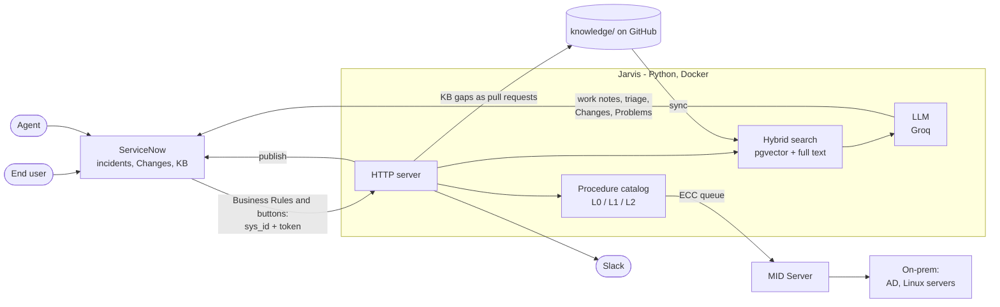

# Jarvis: an AI assistant for the IT Service Desk on ServiceNow

[](https://github.com/tortonef/jarvis-servicenow/actions/workflows/ci.yml)

Jarvis reads every new ServiceNow incident, finds the answer in the knowledge base and in past tickets, and gives the agent a resolution suggestion on the ticket. For known problems it can also fix them on real on-prem systems, with the approval each risk level needs.

It runs on free tiers: a ServiceNow Personal Developer Instance, Groq (GPT-OSS 120B) and local embeddings.


*A real ticket: Jarvis suggests the probable cause and the steps, citing the KB article and the resolved ticket it used.*

## What it does

| For | Jarvis |
|---|---|
| **Service Desk agents** | Writes a resolution suggestion as a work note, with its sources and confidence. Sets category and assignment group when nobody has. Runs safe fixes after a one-click approval. Takes a helpful / not helpful vote on every suggestion. |
| **End users** | Answers questions on the Service Portal from employee articles, before a ticket is opened. |
| **Maintenance team** | Checks AD and Linux servers on-prem through the MID Server. Runs L1 fixes after agent approval and L2 fixes through an approved Change. Proposes Problems from clusters of similar incidents. Sends P1 incidents to Slack with a first diagnosis. |
| **Knowledge owners** | Keeps the KB as Markdown in Git, reviewed by pull request and published to ServiceNow. Turns undocumented fixes into pull requests. Reports weekly on Slack and in a Grafana dashboard. |

<table>
<tr>
<td width="33%"><a href="docs/features.md#procedures-diagnose-propose-approve-verify"></a><br/><sub>Diagnose, approve, fix, verify</sub></td>
<td width="33%"><a href="docs/features.md#support-processes"></a><br/><sub>Self-service on the portal</sub></td>
<td width="33%"><a href="docs/features.md#quality-loop"></a><br/><sub>What Jarvis saved this week</sub></td>
</tr>
</table>

**[See every feature with screenshots →](docs/features.md)**

## How it works



The model writes text; it never chooses an action. Procedures are proposed by rules on diagnostic results, run only from a fixed catalog, and re-checked after they run. Details in [architecture and design choices](docs/design.md).

## Quickstart

1. Create a free **ServiceNow PDI** at [developer.servicenow.com](https://developer.servicenow.com) and a free **Groq key** at [console.groq.com](https://console.groq.com/keys).
2. Copy the settings and fill in the instance, admin credentials, Groq key, a random `JARVIS_TOKEN` and the passwords:

```bash
cp .env.example .env
```

3. Load the demo incidents:

```bash
pip install -r requirements.txt && python -m seed.seed
```

4. Start Jarvis, PostgreSQL, Grafana and a Cloudflare quick tunnel:

```bash
docker compose up -d --build
```

At startup Jarvis installs its ServiceNow side (buttons, Business Rules, KB, portal page) and publishes `knowledge/` to the KB. Open an incident or click **Ask Jarvis**: the work note appears in a few seconds. The dashboard is on [127.0.0.1:3300](http://127.0.0.1:3300).

For the procedures, add the [on-prem lab](docs/on-prem-lab.md). To run without Docker, see [development](docs/development.md).

## Documentation

| | |
|---|---|
| [Features](docs/features.md) | Every feature, with screenshots |
| [Architecture and design choices](docs/design.md) | Detailed flow and why it is built this way |
| [Knowledge base as code](docs/knowledge-as-code.md) | Docs in Git, hybrid search, retrieval quality gate |
| [On-prem lab and MID Server](docs/on-prem-lab.md) | Samba AD, Linux servers, MID Server setup |
| [Development](docs/development.md) | Other run modes, tests, code layout |
| [Architecture plan and roadmap](docs/architecture-plan.md) | Phases 0-5, all done, with notes |
