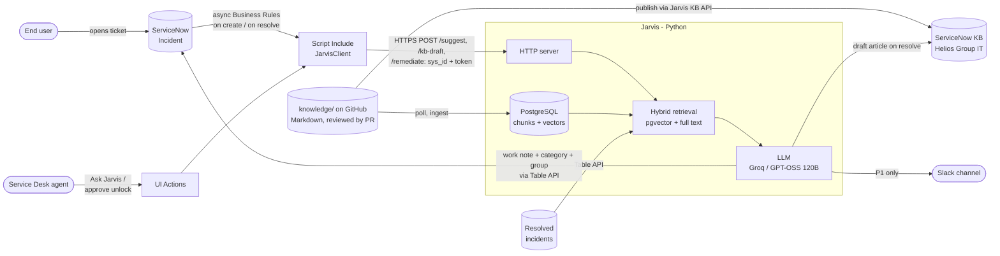
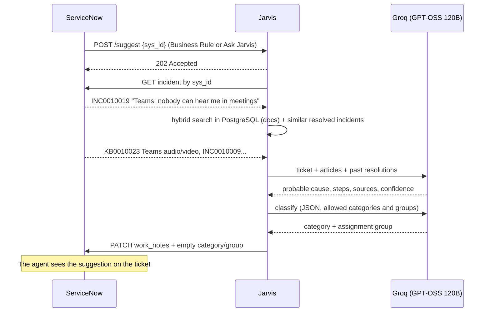
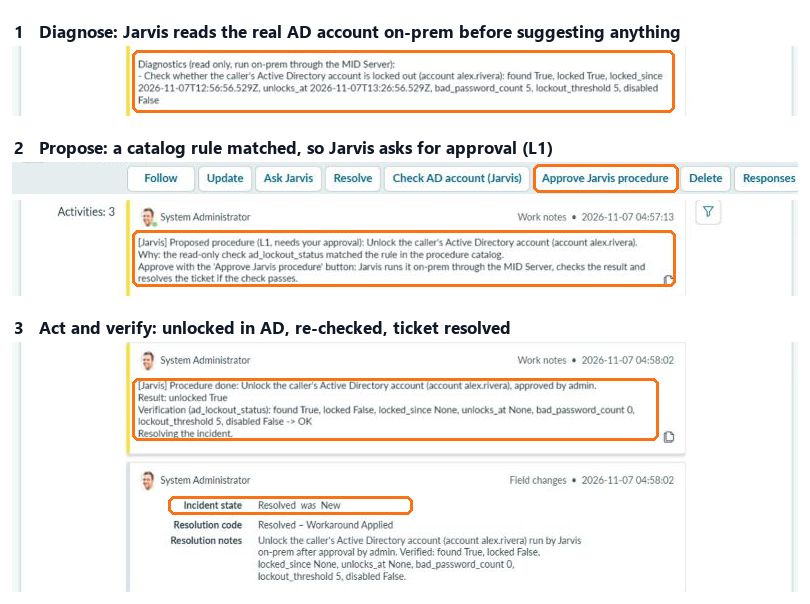
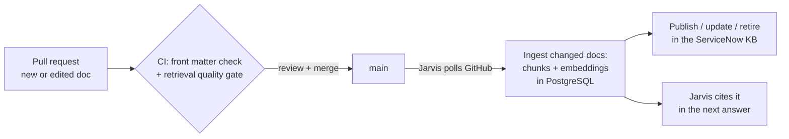
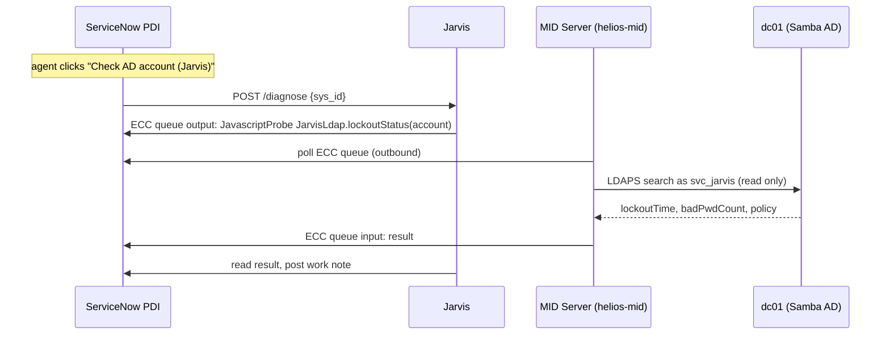
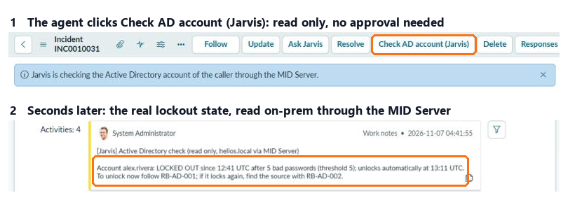
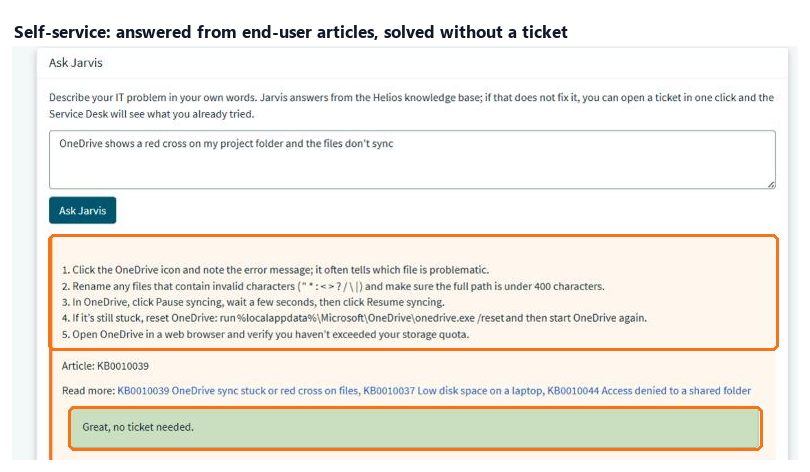
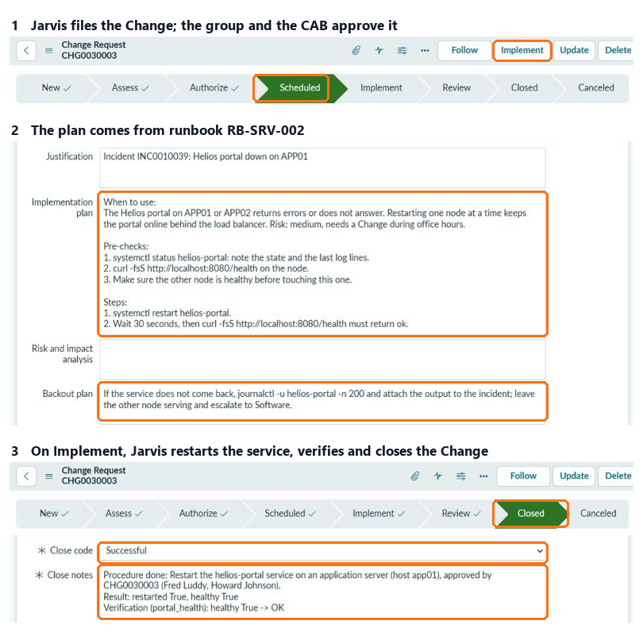

# Jarvis: an AI assistant for the IT Service Desk on ServiceNow

Jarvis reacts to every new ServiceNow incident (or to the **Ask Jarvis** button on the form), searches the **Knowledge Base** and **previously resolved incidents**, posts a **resolution suggestion** for the agent as a work note, and **triages** the ticket: category and assignment group. When a ticket is resolved, it turns the fix into a **draft KB article**, so the knowledge base grows with every solved problem. For known fixes it can also **act**: it proposes a remediation (unlocking a locked-out account), an agent approves it with one click, and Jarvis carries it out. **P1 incidents** are also pushed to Slack with Jarvis's first diagnosis.

It runs on a **free** LLM (Groq, GPT-OSS 120B) and a free ServiceNow **Personal Developer Instance**. The knowledge base is **documentation as code**: Markdown in [`knowledge/`](knowledge/), reviewed by pull request, indexed in PostgreSQL + pgvector and published to the ServiceNow KB.


*A real ticket on a ServiceNow PDI: Jarvis suggests the probable cause and the steps, citing the KB article and the resolved ticket it drew the answer from.*

## How it works





## Live on ServiceNow

A user opens the ticket *"Teams: nobody can hear me in meetings"*. The Business Rule calls Jarvis and about 6 seconds later the agent finds Jarvis's work note in the activity stream:

<p align="center"></p>

The suggestion comes from article **KB0010023** in the demo knowledge base and from resolved ticket **INC0010009**:

<p align="center"></p>

### Ask Jarvis button

Agents can also ask Jarvis on any existing ticket. Here it works on one of the PDI's own demo incidents: no article in the demo KB fits, so Jarvis builds on a similar past ticket and a stock KB article, and honestly reports *medium* confidence.

<p align="center"></p>

### Auto-triage

Jarvis also picks the category and the assignment group. It fills them **only if nobody has set them yet** (category still *Inquiry*, no group), and always writes its choice in the note. Allowed values come from ServiceNow itself: the incident categories and the groups that already handle incidents.

<p align="center"></p>

### Learning loop: KB drafts from resolved tickets

When an incident is resolved, Jarvis reads the agent's resolution notes and the closest articles. If the fix is already documented, it says so and creates nothing. Otherwise it writes a **draft** article, linked to the incident, for a human to review and publish. The next time the same problem comes in, Jarvis finds the answer:

<p align="center"></p>

The draft Jarvis wrote from the agent's notes, linked back to the source incident:

<p align="center"></p>

### Procedures: diagnose, propose, approve, verify

Jarvis can act on real systems, within a catalog it cannot change. [`procedures/catalog.yaml`](procedures/catalog.yaml) lists what exists, each with a risk level, the knowledge documents it belongs to, validated parameters and the rules for proposing and verifying it:

| Procedure | Risk | Runs on |
|---|---|---|
| `ad_lockout_status` | L0, read only, automatic | lab AD (`dc01`) |
| `ad_unlock_account` | L1, agent approval | lab AD (`dc01`) |
| `linux_disk_usage` | L0 | `app01`, `app02` |
| `linux_clean_logs` | L1 | `app01`, `app02` |
| `portal_health` | L0 | `app01`, `app02` |

1. **Diagnose, then suggest.** The L0 checks linked to the documents retrieval found run first, on-prem through the MID Server, and their results go into the prompt and the note.
2. **Propose by rule, not by model.** An L1 is proposed only when its `propose_if` rule holds on those results (account `locked` is true, log volume at least 80%). Parameters come from data: the caller's user name, or the one server named in the ticket out of a fixed list; ambiguous tickets get no proposal.
3. **Approve.** *Approve Jarvis procedure* is shown only while the latest Jarvis note is an open proposal; the click records the approval in the agent's name.
4. **Act and verify.** Jarvis re-checks that the procedure is still needed, runs it, re-runs the L0 check against the `verify` rule, and resolves the ticket only if it passes. Every run, automatic or approved, is logged in the `execution` table.

<p align="center"></p>

The same flow on a Linux server: a ticket about `app01`'s full log volume got two automatic checks (volume 84%, portal healthy), a cleanup proposal, and after approval 40 old logs were deleted, the volume dropped to 1% and the ticket was resolved.

### Knowledge base as code

The documentation of **Helios Group**, a fictional company with its own domain, servers and teams, lives in [`knowledge/`](knowledge/): about 30 documents, articles for users and the Service Desk and runbooks for the maintenance team, Markdown with validated front matter. Changing the knowledge base is a pull request:



- **Search** is hybrid: meaning (local embeddings, [fastembed](https://github.com/qdrant/fastembed) `BAAI/bge-small-en-v1.5`, no API key) plus a small full-text bonus for exact commands and codes, in one PostgreSQL query. Each document is split into a title + symptoms chunk and one chunk per section.
- **Publishing**: ServiceNow refuses to edit published articles through the Table API, so the installer adds a small Scripted REST API (*Jarvis KB*) that creates, updates and retires articles server side. Articles are matched on the document id, so editing a doc updates the same KB number.
- **Only changes move**: documents are skipped by content hash; a deleted doc retires its article. A malformed doc stops the sync and Jarvis keeps serving the last good knowledge base.

Retrieval quality on 40 tickets written the way users and engineers write them (`python -m tests.eval_search`):

| Search | Right document first |
|---|:---:|
| Keyword (ServiceNow-style `LIKE` + ranking) | 80% |
| Semantic, whole documents | 78% |
| **Hybrid, chunked (what Jarvis uses)** | **98%** |

Most of the gain comes from chunking: one vector per section keeps a long runbook from diluting its meaning. The full-text part adds the exact-command cases (*"repadmin shows errors"*). The cases were written together with the documents, so treat 98% as optimistic; CI fails any change that drops hybrid below 85%.

### On-prem lab and MID Server

Jarvis can check real systems on-prem without any inbound connection to them. The lab is a **Samba Active Directory** for `helios.local` (domain controller `dc01`, users in `OU=Staff`, lockout after 5 bad passwords), built from Debian's own packages. A **ServiceNow MID Server**, built from ServiceNow's official container recipe, is the only component that talks to it, and it only connects outbound to the PDI.



- **No paid plugins**: the IntegrationHub SSH and PowerShell steps are not active on a PDI, so Jarvis sends a *JavascriptProbe* that calls a fixed function in a MID Server Script Include (`JarvisLdap`). Only named calls exist (`jarvis/mid.py`), and the account name is validated on the MID before it reaches the LDAP filter.
- **Least privilege**: the MID signs in as `mid.helios` (role `mid_server`, web service access only); LDAP uses `svc_jarvis`, an ordinary account with no admin rights. Its password lives only in the MID container and never passes through ServiceNow.
- **Speed**: about 3 seconds per check once the MID is warm (the very first probe after start took about a minute while the MID synchronized).

<p align="center"></p>

To lock a lab user the way it happens in real life (6 bad passwords): `sh lab/lock-user.sh alex.rivera`.

To run the lab: download ServiceNow's `mid-linux-container-recipe` for your instance version into `lab/mid/recipe/` (it is not redistributed here), then:

```bash
docker build -t mid:brazil-patch2 lab/mid/recipe
```

```bash
docker compose --profile lab up -d --build
```

Set `MID_USER`, `MID_PASSWORD` and the `LAB_*` passwords in `.env` first, and validate the MID Server once in ServiceNow (**MID Server > Servers > helios-mid > Validate**).

### Support processes

**End users: self-service before the ticket.** The Service Portal page `/sp?id=jarvis_help` has an *Ask Jarvis* widget. Jarvis answers only from articles written for employees (runbooks are never shown), in plain steps the user can do alone, and treats the question as data, not instructions. The user clicks *This solved my problem* or *open a ticket*; the ticket then carries the question and the answer already tried, so the agent's suggestion starts from there. Every answer and its outcome is stored, which gives the deflection rate.

<p align="center"></p>

**Maintenance: L2 procedures go through Change.** Restarting the portal affects other users, so `portal_restart` is L2: when `portal_health` reports it down, Jarvis does not offer a button. It files a Normal Change built from runbook RB-SRV-002 (implementation plan from *Pre-checks* and *Steps*, backout plan from *Rollback*, test plan from the `verify` rule) and sends it for approval. ServiceNow's Change model enforces the group and CAB approvals; when the approved Change moves to *Implement*, Jarvis re-checks, restarts the service through the MID Server, verifies, closes the Change as *successful* or *unsuccessful* and resolves the incident.

<p align="center"></p>

**Problems from clusters.** When at least 3 open incidents from the last 24 hours look alike (semantic similarity 0.8 or more), Jarvis files a Problem with the incidents, its likely cause, and links them; later look-alikes join the open Problem. Similarity measures symptoms, not causes: a hotel VPN error scores 0.82 against an office-wide VPN outage, so the Problem is a proposal and the problem manager unlinks what does not belong.

**Weekly report.** Every Monday Jarvis posts to Slack: incidents answered and those with no matching article, self-service deflection, procedures run by risk and status, failures, Problems proposed and documents due for review (`python -m jarvis.report` prints it any time).

### P1 alerts on Slack

When the ticket is a P1 (impact and urgency high), Jarvis posts to a Slack channel as soon as its suggestion is ready: title linked to the incident, probable cause, confidence and KB sources, so the on-call team starts from a diagnosis instead of a bare alert. Set `NOTIFY_WEBHOOK_URL` to a Slack [Incoming Webhook](https://api.slack.com/messaging/webhooks); leave it empty to disable.

<p align="center"></p>

## Design choices

| Choice | Why |
|---|---|
| **ServiceNow stays the record for tickets** | Incidents, approvals and history live in ServiceNow; PostgreSQL holds only Jarvis's own data: the knowledge index, vector cache and audit trail. |
| **Docs as code, one-way to ServiceNow** | Git gives versioning, review by pull request and a quality gate for free; the ServiceNow KB is a read-only mirror, so the two never drift. |
| **Local embeddings** | Free and private: ticket text never leaves the machine for search. |
| **Push, with polling as fallback** | An async Business Rule and the *Ask Jarvis* button call Jarvis right away. Where ServiceNow cannot reach Jarvis, `jarvis.main` polls instead (no tunnel, nothing installed in ServiceNow). |
| **Untrusted caller** | The Jarvis endpoint requires a shared token, accepts only a 32-hex `sys_id` and re-reads the incident from ServiceNow; it never trusts ticket text sent in the request. |
| **A single LLM call (RAG)** | More predictable and faster than a tool-calling agent, and fits the free-tier limits. |
| **Dedicated KB with Instant Publish** | The PDI's "IT" KB has an approval flow; in *Helios Group IT* the approval is the pull request, and the stock KBs stay untouched. |
| **OpenAI-compatible API** | Groq, local Ollama, Gemini, OpenAI or Claude: just change `.env`. |
| **Triage never overrides people** | LLM output is checked against ServiceNow's own categories and groups; invented values are dropped, fields an agent already set are left alone, and a triage failure never blocks the resolution note. |
| **KB drafts need a human** | Jarvis only creates drafts; publishing stays a human decision. Model output is HTML-escaped before it goes into the article, and a `covered_by` answer is trusted only if it names an article Jarvis actually showed the model. |
| **Actions are layered allowlists** | The model never picks or writes an action. The catalog, Jarvis's parameter checks, the MID Script Includes (named functions, `OU=Staff` only, allowed hosts and verbs), AD delegation (`svc_jarvis` may write `lockoutTime` and nothing else) and an SSH forced command on each server must all agree. A call to `/approve` without a pending proposal and the agent's approval note does nothing, even with a valid token. |
| **Alerts can't be hijacked by ticket text** | Ticket text is escaped before it reaches Slack, so a title like `<!channel>` cannot ping the whole channel. A Slack outage is logged and never costs the work note. |
| **On-prem only through the MID Server** | ServiceNow's own outbound-only bridge: no firewall opening into the lab, ServiceNow keeps the ECC queue as an audit trail, and Jarvis can only call named MID functions. |
| **L2 needs an approved Change** | Jarvis files the Change, but only ServiceNow's Change model can move it to Implement; Jarvis then re-reads the Change, needs it approved and in Implement, and its correlation id and number must match the pending L2 in its log. |
| **Self-service sees only end-user articles** | The portal search filters on the document audience; runbooks and admin procedures never reach employees, and the answer prompt refuses admin steps. |
| **Work note, not a comment** | The suggestion is visible to agents only, never to the end user. |

## Quickstart

1. **ServiceNow**: create a free Personal Developer Instance at [developer.servicenow.com](https://developer.servicenow.com).
2. **LLM**: create a free API key at [console.groq.com](https://console.groq.com/keys).
3. Install and configure:

```bash
pip install -r requirements.txt
```

```bash
cp .env.example .env
```

Fill in `.env` with the instance URL, admin credentials, Groq key, a random `JARVIS_TOKEN` and `DOCS_REPO` (the GitHub repo holding `knowledge/`), then load the demo incidents and the lockout demo user:

```bash
python -m seed.seed
```

The KB articles are not seeded: Jarvis publishes `knowledge/` to the ServiceNow KB *Helios Group IT* when it starts.

### Run with Docker (recommended)

Requires Docker. Set `POSTGRES_PASSWORD` in `.env`, then:

```bash
docker compose up -d --build
```

This starts three containers: **PostgreSQL + pgvector** (embedding cache and an audit trail of every suggestion), the **Jarvis server**, and a free [Cloudflare quick tunnel](https://developers.cloudflare.com/cloudflare-one/connections/connect-networks/do-more-with-tunnels/trycloudflare/) (no account needed). At startup Jarvis reads the tunnel's public URL and installs the ServiceNow side with it: system properties, `JarvisClient` Script Include, *Ask Jarvis*, *Check AD account (Jarvis)* and *Approve Jarvis procedure* buttons, async Business Rules on incidents and Changes, the *Helios Group IT* knowledge base, the *Jarvis KB* API and the self-service portal page. Then it syncs `knowledge/` from GitHub and checks for new commits every `DOCS_POLL_SECONDS`. Quick-tunnel URLs change when cloudflared restarts; Jarvis checks on every loop and re-registers. A quick tunnel can also expire (cloudflared logs *Tunnel not found*): run `docker compose restart tunnel` and Jarvis follows within one loop. For a stable URL, use a named Cloudflare tunnel on your own domain.

The first start embeds the KB and the ticket history (about 30 seconds on the PDI); later starts load the vectors from PostgreSQL (about 3 seconds).

Create an incident or click **Ask Jarvis** on an existing one: the work note appears in a few seconds. Resolve an incident with resolution notes to get a KB draft. For the procedures, lock the demo user **Alex Rivera** in the lab AD (`sh lab/lock-user.sh alex.rivera`) and open an incident with Alex as caller, or stop the portal on a server (`sh lab/break-portal.sh app01`) and open an incident about it.

### Push mode without Docker

```bash
python -m jarvis.server
```

```bash
cloudflared tunnel --url http://127.0.0.1:8787
```

```bash
python -m seed.install_snow https://<your-tunnel>.trycloudflare.com
```

Without `DATABASE_URL` Jarvis keeps vectors in memory, skips the audit trail and answers from whatever is already in the ServiceNow KB (no docs sync). `python -m jarvis.knowledge sync` publishes `knowledge/` once.

### Polling mode (no tunnel)

```bash
python -m jarvis.main
```

Jarvis checks for new incidents every 30 seconds. Use one mode at a time, or new tickets get two notes.

## Tests

```bash
python -m unittest -v
```

The database tests and the retrieval eval run against a real PostgreSQL when `TEST_DATABASE_URL` is set (with Docker, a separate database: `postgresql://jarvis:<POSTGRES_PASSWORD>@127.0.0.1:55432/jarvis_test`). CI runs on every push and pull request: front matter check, all tests on a pgvector service, the retrieval quality gate with the real model, and the Docker build.

Tests run offline (ServiceNow, the LLM and the embedding model are faked). They check that every document in `knowledge/` is valid, that the docs loader reads only `knowledge/` files from the GitHub tarball and never writes them to disk, that Markdown becomes escaped KB HTML, that ingestion skips unchanged docs and retires deleted ones, that the HTTP endpoint rejects a wrong token, a malformed `sys_id` and invalid JSON, that triage fills only empty fields and drops invented or malformed LLM output, that KB drafts are escaped, linked to the incident and skipped when the fix is already documented, that the procedure catalog is valid, that parameters never come from free text, that L1 procedures are proposed only when their rule holds, and that approval without a proposal, a tampered parameter, a no-longer-needed action or a failed verification never resolves a ticket. Slack alerts are tested for P1-only sending, escaping and failure handling (no real HTTP calls). The semantic index is tested for ranking, the relevance threshold and embedding caching; `python -m tests.eval_search` measures retrieval quality with the real model.

## Layout

```
jarvis/snow.py     ServiceNow REST client + search and ranking
jarvis/agent.py    prompts and LLM calls
jarvis/semantic.py semantic ranking with cached local embeddings
jarvis/mid.py      named MID Server calls through the ECC queue
jarvis/procedures.py procedure catalog: validation, parameters, proposal and verification rules
jarvis/selfservice.py portal answers from end-user articles, deflection tracking
jarvis/problems.py Problem proposals from clusters of similar incidents
jarvis/report.py   weekly health report
procedures/        catalog.yaml: what Jarvis may run, at which risk level
jarvis/knowledge.py docs as code: validate, ingest, hybrid search, publish to the KB
knowledge/         the Helios Group knowledge base (articles + runbooks)
jarvis/notify.py   Slack alert for P1 incidents
jarvis/db.py       PostgreSQL: migrations, vector cache, suggestion audit
db/migrations/     SQL migrations, applied at startup
jarvis/server.py   push mode: HTTP endpoint called by ServiceNow
jarvis/main.py     polling mode + shared handle() logic
jarvis/config.py   .env loading
seed/              demo incidents and user, install_snow.py, mid/ (MID Script Includes), portal/ (Ask Jarvis widget)
lab/               on-prem lab: dc01 (Samba AD), app01/app02, the MID Server image, lock-user.sh
tests/             tests + eval_search.py (keyword vs semantic vs hybrid, the CI quality gate)
```

## Roadmap

- [x] **Step 1**: resolution suggestion from the KB and ticket history
- [x] **Step 2**: "Ask Jarvis" button on the form and push via async Business Rule
- [x] **Step 3**: auto-categorization and assignment group
- [x] **Step 4**: draft KB article from resolved incidents whose fix is not documented yet
- [x] **Step 5**: procedures with risk levels and agent approval, run on-prem (AD unlock, log cleanup)
- [x] **Step 6**: semantic search with local embeddings
- [x] **Step 7**: Slack alert for P1 tickets

**Next:** [Jarvis 2.0 architecture and roadmap](docs/architecture-plan.md) (Phase 0 done: Docker, PostgreSQL + pgvector, CI. Phase 1 done: knowledge base as code. Phase 2 done: on-prem lab and MID Server. Phase 3 done: procedure catalog. Phase 4 done: self-service, L2 through Change, Problems, weekly report). Next up: the quality loop (feedback buttons, dashboards, KB gaps as pull requests).
