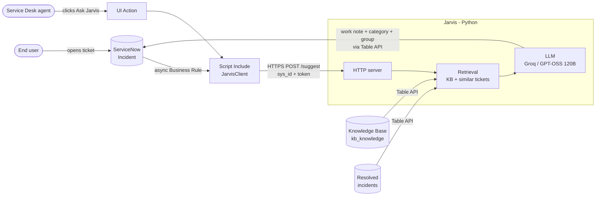
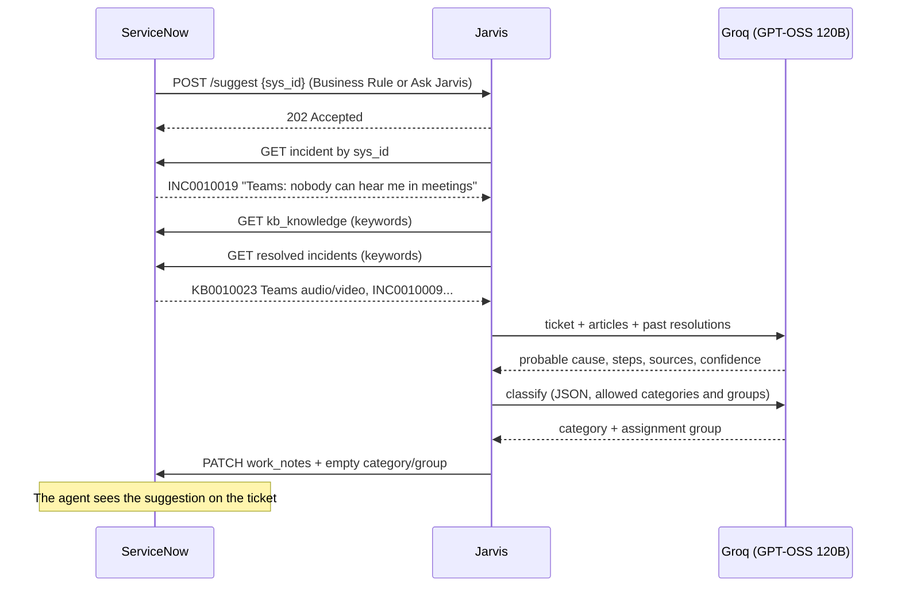

# Jarvis: an AI assistant for the IT Service Desk on ServiceNow

Jarvis reacts to every new ServiceNow incident (or to the **Ask Jarvis** button on the form), searches the **Knowledge Base** and **previously resolved incidents**, posts a **resolution suggestion** for the agent as a work note, and **triages** the ticket: category and assignment group.

It runs on a **free** LLM (Groq, GPT-OSS 120B) and a free ServiceNow **Personal Developer Instance**. No external database is needed: ServiceNow already is the data source.


*A real ticket on a ServiceNow PDI: Jarvis suggests the probable cause and the steps, citing the KB article and the resolved ticket it drew the answer from.*

## How it works





## Live on ServiceNow

A user opens the ticket *"Teams: nobody can hear me in meetings"*. The Business Rule calls Jarvis and about 6 seconds later the agent finds Jarvis's work note in the activity stream:

<p align="center"></p>

The suggestion comes from article **KB0010023** in the demo knowledge base and from resolved ticket **INC0010009**:

<p align="center"></p>

### Ask Jarvis button

Agents can also ask Jarvis on any existing ticket. Here it works on one of the PDI's own demo incidents: no article in the demo KB fits, so Jarvis builds on a similar past ticket and a stock KB article, and honestly reports *medium* confidence.

<p align="center"></p>

### Auto-triage

Jarvis also picks the category and the assignment group. It fills them **only if nobody has set them yet** (category still *Inquiry*, no group), and always writes its choice in the note. Allowed values come from ServiceNow itself: the incident categories and the groups that already handle incidents.

<p align="center"></p>

## Design choices

| Choice | Why |
|---|---|
| **No external database** | Incidents, KB and history already live in ServiceNow. Jarvis does not duplicate data. |
| **Keyword search + local ranking** | Good enough for tens or hundreds of articles. With thousands, move to embeddings + a vector DB (pgvector/Chroma). |
| **Push, with polling as fallback** | An async Business Rule and the *Ask Jarvis* button call Jarvis right away. Where ServiceNow cannot reach Jarvis, `jarvis.main` polls instead (no tunnel, nothing installed in ServiceNow). |
| **Untrusted caller** | The Jarvis endpoint requires a shared token, accepts only a 32-hex `sys_id` and re-reads the incident from ServiceNow; it never trusts ticket text sent in the request. |
| **A single LLM call (RAG)** | More predictable and faster than a tool-calling agent, and fits the free-tier limits. |
| **Dedicated KB with Instant Publish** | The PDI's "IT" KB has an approval flow: the seed creates "IT Service Desk (Jarvis demo)" and leaves the original untouched. |
| **OpenAI-compatible API** | Groq, local Ollama, Gemini, OpenAI or Claude: just change `.env`. |
| **Triage never overrides people** | LLM output is checked against ServiceNow's own categories and groups; invented values are dropped, fields an agent already set are left alone, and a triage failure never blocks the resolution note. |
| **Work note, not a comment** | The suggestion is visible to agents only, never to the end user. |

## Quickstart

1. **ServiceNow**: create a free Personal Developer Instance at [developer.servicenow.com](https://developer.servicenow.com).
2. **LLM**: create a free API key at [console.groq.com](https://console.groq.com/keys).
3. Install and configure:

```bash
pip install -r requirements.txt
```

```bash
cp .env.example .env
```

Fill in `.env` with the instance URL, admin credentials, Groq key and a random `JARVIS_TOKEN`, then load the demo data:

```bash
python -m seed.seed
```

ServiceNow does not allow publishing KB articles through the Table API: open **System Definition > Scripts - Background**, paste [`seed/publish_kb.js`](seed/publish_kb.js) and click *Run script*.

### Push mode (recommended)

ServiceNow must reach Jarvis over HTTPS. For a demo, a free [Cloudflare quick tunnel](https://developers.cloudflare.com/cloudflare-one/connections/connect-networks/do-more-with-tunnels/trycloudflare/) is enough (no account needed). Start the server and the tunnel in two terminals:

```bash
python -m jarvis.server
```

```bash
cloudflared tunnel --url http://127.0.0.1:8787
```

Then install the ServiceNow side (system properties, `JarvisClient` Script Include, *Ask Jarvis* button, async Business Rule) with the tunnel URL:

```bash
python -m seed.install_snow https://<your-tunnel>.trycloudflare.com
```

Create an incident or click **Ask Jarvis** on an existing one: the work note appears in a few seconds. Quick-tunnel URLs change on every restart, so re-run `install_snow` with the new URL.

### Polling mode (no tunnel)

```bash
python -m jarvis.main
```

Jarvis checks for new incidents every 30 seconds. Use one mode at a time, or new tickets get two notes.

## Tests

```bash
python -m unittest -v
```

Tests run offline (ServiceNow and the LLM are faked). They check that retrieval finds the right KB article for every demo ticket, that the HTTP endpoint rejects a wrong token, a malformed `sys_id` and invalid JSON, and that triage fills only empty fields and drops invented or malformed LLM output.

## Layout

```
jarvis/snow.py     ServiceNow REST client + search and ranking
jarvis/agent.py    prompt and LLM call
jarvis/server.py   push mode: HTTP endpoint called by ServiceNow
jarvis/main.py     polling mode + shared handle() logic
jarvis/config.py   .env loading
seed/              demo data, KB publish script, install_snow.py for the ServiceNow side
tests/             offline tests
```

## Roadmap

- [x] **Step 1**: resolution suggestion from the KB and ticket history
- [x] **Step 2**: "Ask Jarvis" button on the form and push via async Business Rule
- [x] **Step 3**: auto-categorization and assignment group
- [ ] Draft KB article generated from resolved incidents that have no article
- [ ] Teams/Slack notification for P1 tickets
- [ ] Auto-remediation (e.g. password reset, account unlock) with agent approval
- [ ] Semantic search with embeddings as the KB grows
