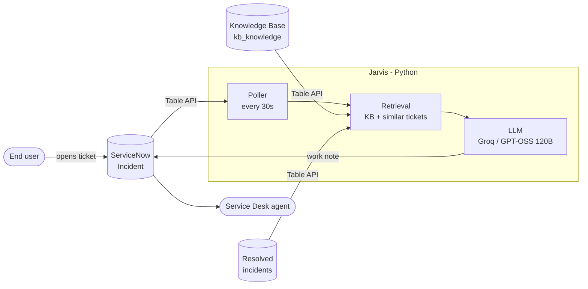
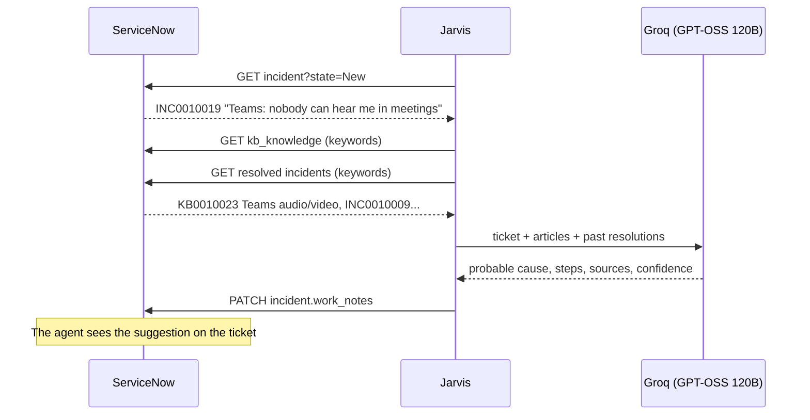

# Jarvis: an AI assistant for the IT Service Desk on ServiceNow

Jarvis reads every new ServiceNow incident, searches the **Knowledge Base** and **previously resolved incidents**, and posts a **resolution suggestion** for the agent as a work note, right on the ticket.

It runs on a **free** LLM (Groq, GPT-OSS 120B) and a free ServiceNow **Personal Developer Instance**. No external database is needed: ServiceNow already is the data source.


*A real ticket on a ServiceNow PDI: Jarvis suggests the probable cause and the steps, citing the KB article and the resolved ticket it drew the answer from.*

## How it works





## Live on ServiceNow

A user opens the ticket *"Teams: nobody can hear me in meetings"*. A few seconds later the agent finds Jarvis's work note in the activity stream:

<p align="center"></p>

The suggestion comes from article **KB0010023** in the demo knowledge base and from resolved ticket **INC0010009**:

<p align="center"></p>

## Design choices

| Choice | Why |
|---|---|
| **No external database** | Incidents, KB and history already live in ServiceNow. Jarvis does not duplicate data. |
| **Keyword search + local ranking** | Good enough for tens or hundreds of articles. With thousands, move to embeddings + a vector DB (pgvector/Chroma). |
| **Polling instead of a Business Rule** | No tunnel (ngrok) and no code to install in ServiceNow. Push is on the roadmap. |
| **A single LLM call (RAG)** | More predictable and faster than a tool-calling agent, and fits the free-tier limits. |
| **Dedicated KB with Instant Publish** | The PDI's "IT" KB has an approval flow: the seed creates "IT Service Desk (Jarvis demo)" and leaves the original untouched. |
| **OpenAI-compatible API** | Groq, local Ollama, Gemini, OpenAI or Claude: just change `.env`. |
| **Work note, not a comment** | The suggestion is visible to agents only, never to the end user. |

## Quickstart

1. **ServiceNow**: create a free Personal Developer Instance at [developer.servicenow.com](https://developer.servicenow.com).
2. **LLM**: create a free API key at [console.groq.com](https://console.groq.com/keys).
3. Configure and run:

```bash
pip install -r requirements.txt
```

```bash
cp .env.example .env
```

Fill in `.env` with the instance URL, admin credentials and Groq key, then:

```bash
python -m seed.seed
```

ServiceNow does not allow publishing KB articles through the Table API: open **System Definition > Scripts - Background**, paste [`seed/publish_kb.js`](seed/publish_kb.js) and click *Run script*. Then:

```bash
python -m jarvis.main
```

`seed` loads 15 KB articles, 10 resolved incidents and 5 open incidents. Jarvis answers the 5 open ones right away (plus any PDI demo incidents in state New); then create a new incident from the UI and wait about 30 seconds.

## Tests

```bash
python -m unittest -v
```

Tests run offline (ServiceNow and the LLM are faked) and also check that retrieval finds the right KB article for every demo ticket.

## Layout

```
jarvis/snow.py     ServiceNow REST client + search and ranking
jarvis/agent.py    prompt and LLM call
jarvis/main.py     polling loop
jarvis/config.py   .env loading
seed/              demo KB articles and incidents, load script and KB publish script
tests/             offline tests
```

## Roadmap

- [x] **Step 1**: resolution suggestion from the KB and ticket history
- [ ] "Ask Jarvis" UI Action on the form and push via Business Rule (instead of polling)
- [ ] Auto-categorization and assignment group suggestion
- [ ] Draft KB article generated from resolved incidents that have no article
- [ ] Teams/Slack notification for P1 tickets
- [ ] Auto-remediation (e.g. password reset, account unlock) with agent approval
- [ ] Semantic search with embeddings as the KB grows
