# Jarvis: an AI assistant for the IT Service Desk on ServiceNow

Jarvis reacts to every new ServiceNow incident (or to the **Ask Jarvis** button on the form), searches the **Knowledge Base** and **previously resolved incidents**, posts a **resolution suggestion** for the agent as a work note, and **triages** the ticket: category and assignment group. When a ticket is resolved, it turns the fix into a **draft KB article**, so the knowledge base grows with every solved problem. For known fixes it can also **act**: it proposes a remediation (unlocking a locked-out account), an agent approves it with one click, and Jarvis carries it out. **P1 incidents** are also pushed to Slack with Jarvis's first diagnosis.

It runs on a **free** LLM (Groq, GPT-OSS 120B) and a free ServiceNow **Personal Developer Instance**. No external database is needed: ServiceNow already is the data source.

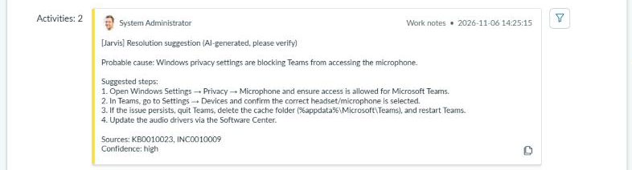

*A real ticket on a ServiceNow PDI: Jarvis suggests the probable cause and the steps, citing the KB article and the resolved ticket it drew the answer from.*

## How it works

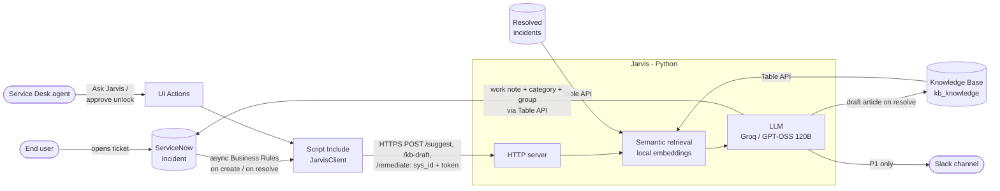

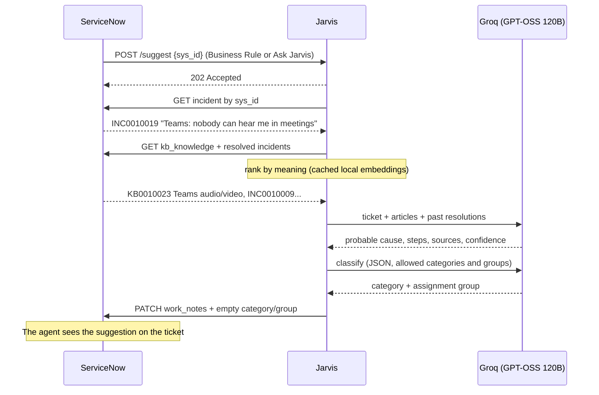

## Live on ServiceNow

A user opens the ticket *"Teams: nobody can hear me in meetings"*. The Business Rule calls Jarvis and about 6 seconds later the agent finds Jarvis's work note in the activity stream:

<p align="center">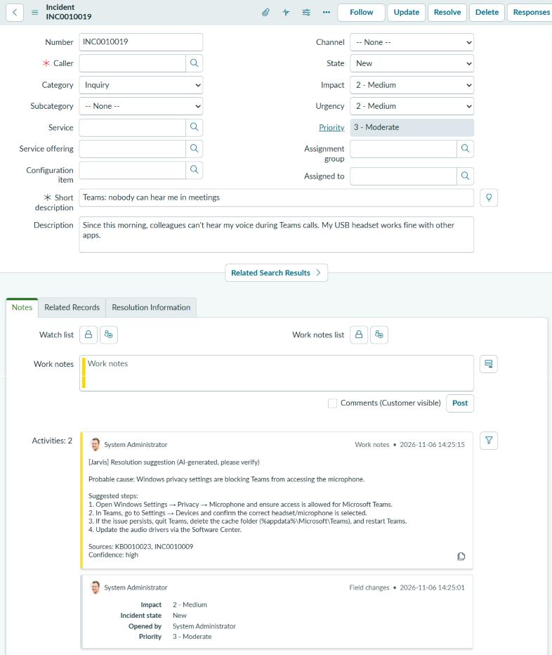</p>

The suggestion comes from article **KB0010023** in the demo knowledge base and from resolved ticket **INC0010009**:

<p align="center">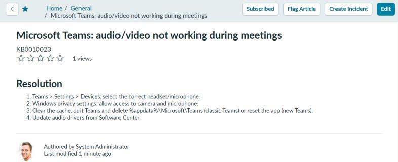</p>

### Ask Jarvis button

Agents can also ask Jarvis on any existing ticket. Here it works on one of the PDI's own demo incidents: no article in the demo KB fits, so Jarvis builds on a similar past ticket and a stock KB article, and honestly reports *medium* confidence.

<p align="center">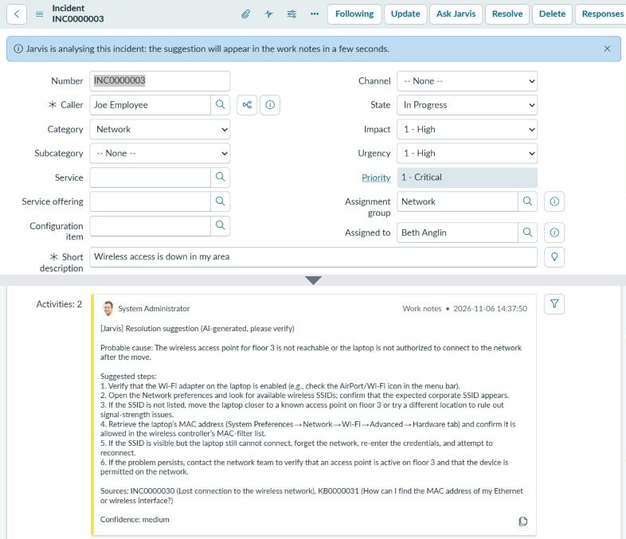</p>

### Auto-triage

Jarvis also picks the category and the assignment group. It fills them **only if nobody has set them yet** (category still *Inquiry*, no group), and always writes its choice in the note. Allowed values come from ServiceNow itself: the incident categories and the groups that already handle incidents.

<p align="center">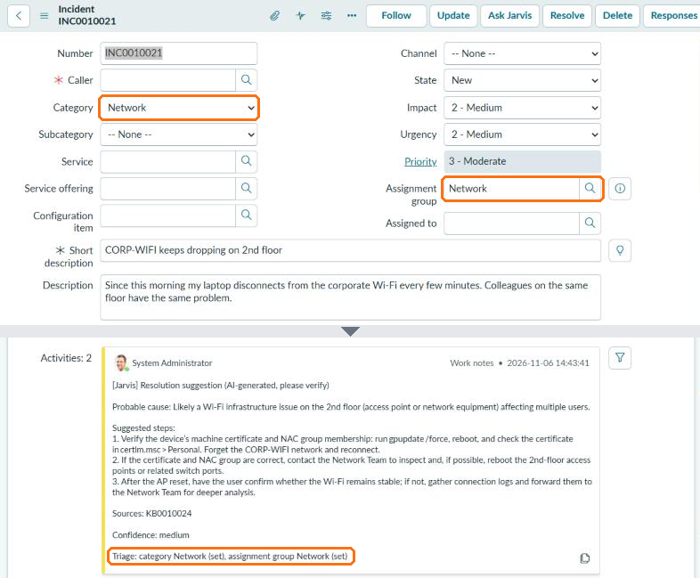</p>

### Learning loop: KB drafts from resolved tickets

When an incident is resolved, Jarvis reads the agent's resolution notes and the closest articles. If the fix is already documented, it says so and creates nothing. Otherwise it writes a **draft** article, linked to the incident, for a human to review and publish. The next time the same problem comes in, Jarvis finds the answer:

<p align="center">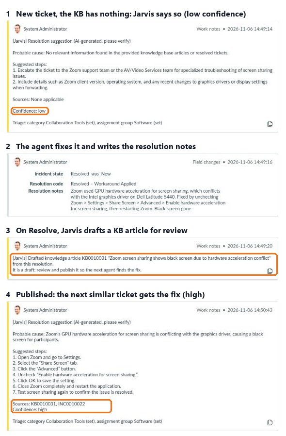</p>

The draft Jarvis wrote from the agent's notes, linked back to the source incident:

<p align="center">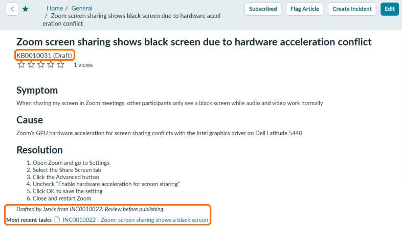</p>

### Auto-remediation with approval

When a ticket is about a locked-out account, Jarvis does more than explain the fix. The model flags the intent, and Jarvis checks the data: is the caller really locked out in ServiceNow? Only then does it propose the action. An agent approves with the **Unlock account (Jarvis)** button, which is shown only while the caller is locked and records the approval as a work note in the agent's name. Jarvis re-checks the approval and the lockout, unlocks the account and resolves the ticket, which in turn triggers the KB check:

<p align="center">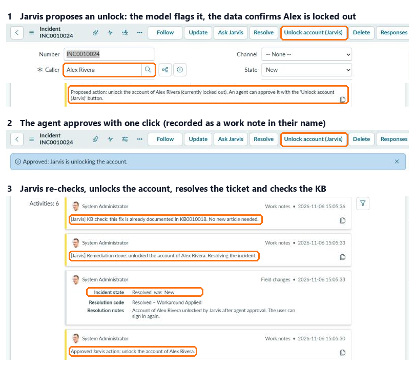</p>

> The PDI has no Active Directory, so the demo unlocks the ServiceNow user (`sys_user.locked_out`). In production the same step would call Active Directory or Entra ID.

### Semantic search

Users rarely use the words of the KB title. Jarvis ranks articles and past tickets by meaning, with a small embedding model that runs locally ([fastembed](https://github.com/qdrant/fastembed), `BAAI/bge-small-en-v1.5`, no API key). Vectors are cached and only new or edited records are embedded; the server builds the index at startup (about 20 seconds on the PDI), after which a note takes about 5 seconds.

On 10 demo tickets written the way users write them (`python -m tests.eval_search`):

| Ticket | Right article | Keyword | Semantic |
|---|---|:---:|:---:|
| PC asks for a 48-digit code when I turn it on | BitLocker | ✗ | ✓ |
| My laptop takes ages to boot and the fan is always loud | Slow laptop | ✗ | ✓ |
| I need permission to open the finance team's network drive | Shared folder access | ✗ | ✓ |
| I press print and nothing comes out, documents wait forever | Printer queue | ✗ | ✓ |
| Big workbook makes the spreadsheet program shut down | Excel crashes | ✗ | ✓ |
| 5 more tickets that share words with the article | | ✓ | ✓ |
| **Right article first** | | **5/10** | **10/10** |

An article scores the best of its title and its full text: scoring the full text alone gave 8/10, because long bodies dilute the meaning. That choice was made on these same 10 tickets, so treat 10/10 as optimistic. Off-topic tickets ("the coffee machine is broken") get no articles at all. Set `SEARCH=keyword` to run without the model.

### P1 alerts on Slack

When the ticket is a P1 (impact and urgency high), Jarvis posts to a Slack channel as soon as its suggestion is ready: title linked to the incident, probable cause, confidence and KB sources, so the on-call team starts from a diagnosis instead of a bare alert. Set `NOTIFY_WEBHOOK_URL` to a Slack [Incoming Webhook](https://api.slack.com/messaging/webhooks); leave it empty to disable.

<p align="center">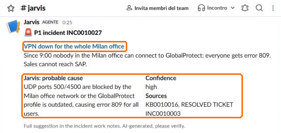</p>

## Design choices

| Choice | Why |
|---|---|
| **No external database** | Incidents, KB and history already live in ServiceNow. Jarvis does not duplicate data. |
| **Local embeddings, in memory** | Free, private (ticket text never leaves the machine for search) and fast for the 500 most recent records per table. With tens of thousands, move the vectors to a vector DB (pgvector/Chroma) or use ServiceNow AI Search. |
| **Push, with polling as fallback** | An async Business Rule and the *Ask Jarvis* button call Jarvis right away. Where ServiceNow cannot reach Jarvis, `jarvis.main` polls instead (no tunnel, nothing installed in ServiceNow). |
| **Untrusted caller** | The Jarvis endpoint requires a shared token, accepts only a 32-hex `sys_id` and re-reads the incident from ServiceNow; it never trusts ticket text sent in the request. |
| **A single LLM call (RAG)** | More predictable and faster than a tool-calling agent, and fits the free-tier limits. |
| **Dedicated KB with Instant Publish** | The PDI's "IT" KB has an approval flow: the seed creates "IT Service Desk (Jarvis demo)" and leaves the original untouched. |
| **OpenAI-compatible API** | Groq, local Ollama, Gemini, OpenAI or Claude: just change `.env`. |
| **Triage never overrides people** | LLM output is checked against ServiceNow's own categories and groups; invented values are dropped, fields an agent already set are left alone, and a triage failure never blocks the resolution note. |
| **KB drafts need a human** | Jarvis only creates drafts; publishing stays a human decision. Model output is HTML-escaped before it goes into the article, and a `covered_by` answer is trusted only if it names an article Jarvis actually showed the model. |
| **Actions need a recorded human approval** | The model can only flag an intent; the proposal requires the data to agree, and `/remediate` acts only if it finds the agent's approval note and the account is still locked. A call without approval is refused even with a valid token. |
| **Alerts can't be hijacked by ticket text** | Ticket text is escaped before it reaches Slack, so a title like `<!channel>` cannot ping the whole channel. A Slack outage is logged and never costs the work note. |
| **Work note, not a comment** | The suggestion is visible to agents only, never to the end user. |

## Quickstart

1. **ServiceNow**: create a free Personal Developer Instance at [developer.servicenow.com](https://developer.servicenow.com).
2. **LLM**: create a free API key at [console.groq.com](https://console.groq.com/keys).
3. Install and configure:

```bash
pip install -r requirements.txt
```

```bash
cp .env.example .env
```

Fill in `.env` with the instance URL, admin credentials, Groq key and a random `JARVIS_TOKEN`, then load the demo data:

```bash
python -m seed.seed
```

ServiceNow does not allow publishing KB articles through the Table API: open **System Definition > Scripts - Background**, paste [`seed/publish_kb.js`](seed/publish_kb.js) and click *Run script*.

### Push mode (recommended)

ServiceNow must reach Jarvis over HTTPS. For a demo, a free [Cloudflare quick tunnel](https://developers.cloudflare.com/cloudflare-one/connections/connect-networks/do-more-with-tunnels/trycloudflare/) is enough (no account needed). Start the server and the tunnel in two terminals:

```bash
python -m jarvis.server
```

```bash
cloudflared tunnel --url http://127.0.0.1:8787
```

Then install the ServiceNow side (system properties, `JarvisClient` Script Include, *Ask Jarvis* button, async Business Rules on create and on resolve) with the tunnel URL:

```bash
python -m seed.install_snow https://<your-tunnel>.trycloudflare.com
```

Create an incident or click **Ask Jarvis** on an existing one: the work note appears in a few seconds. Resolve an incident with resolution notes to get a KB draft. For auto-remediation, `seed` creates the demo user **Alex Rivera** in locked-out state (re-run it to lock him again): open an incident with Alex as caller saying the account is locked. Quick-tunnel URLs change on every restart, so re-run `install_snow` with the new URL.

### Polling mode (no tunnel)

```bash
python -m jarvis.main
```

Jarvis checks for new incidents every 30 seconds. Use one mode at a time, or new tickets get two notes.

## Tests

```bash
python -m unittest -v
```

Tests run offline (ServiceNow, the LLM and the embedding model are faked). They check that retrieval finds the right KB article for every demo ticket, that the HTTP endpoint rejects a wrong token, a malformed `sys_id` and invalid JSON, that triage fills only empty fields and drops invented or malformed LLM output, that KB drafts are escaped, linked to the incident and skipped when the fix is already documented, and that an unlock is proposed only when model and data agree and executed only after a recorded approval. Slack alerts are tested for P1-only sending, escaping and failure handling (no real HTTP calls). The semantic index is tested for ranking, the relevance threshold and embedding caching; `python -m tests.eval_search` measures retrieval quality with the real model.

## Layout

```
jarvis/snow.py     ServiceNow REST client + search and ranking
jarvis/agent.py    prompts and LLM calls
jarvis/semantic.py semantic ranking with cached local embeddings
jarvis/notify.py   Slack alert for P1 incidents
jarvis/server.py   push mode: HTTP endpoint called by ServiceNow
jarvis/main.py     polling mode + shared handle() logic
jarvis/config.py   .env loading
seed/              demo data, KB publish script, install_snow.py for the ServiceNow side
tests/             offline tests + eval_search.py (keyword vs semantic)
```

## Roadmap

- [x] **Step 1**: resolution suggestion from the KB and ticket history
- [x] **Step 2**: "Ask Jarvis" button on the form and push via async Business Rule
- [x] **Step 3**: auto-categorization and assignment group
- [x] **Step 4**: draft KB article from resolved incidents whose fix is not documented yet
- [x] **Step 5**: auto-remediation with agent approval (account unlock)
- [x] **Step 6**: semantic search with local embeddings
- [x] **Step 7**: Slack alert for P1 tickets

**Next:** [Jarvis 2.0 architecture and roadmap](docs/architecture-plan.md): PostgreSQL + pgvector, docs as code synced to the ServiceNow KB, a procedure catalog with risk levels running on an on-prem lab through the MID Server, and the end-user and maintenance support processes.
