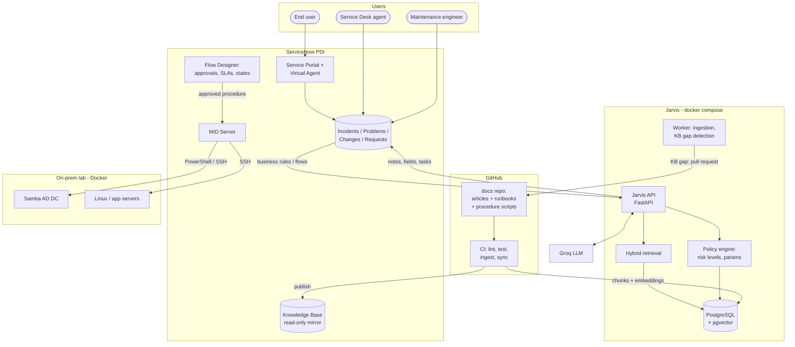
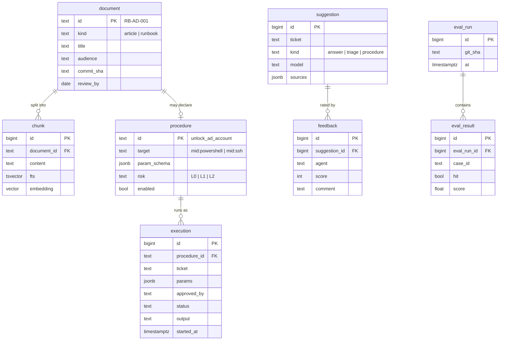
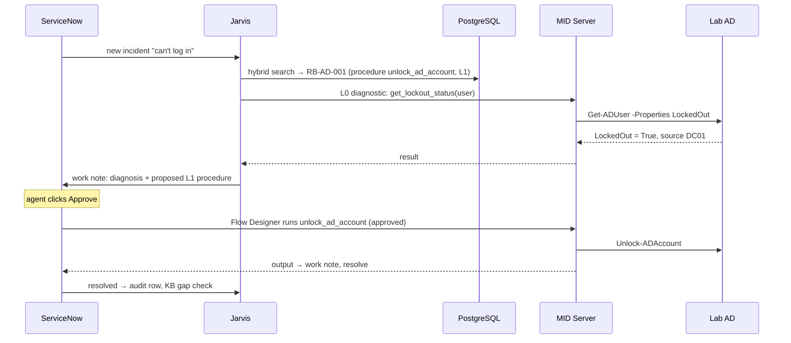

# Jarvis 2.0: target architecture and roadmap

The demo in this repo proves the ideas on a ServiceNow PDI with seeded data. This document plans the next stage: a realistic setup for a fictional company, **Helios Group**, with a real knowledge base, a database, procedures that run on on-prem systems, and two orchestrated support processes. It stays free to run: ServiceNow PDI, Groq free tier, open-source components, a home lab in Docker.

## 1. Goals

1. **Knowledge first.** Every answer and every action comes from versioned, reviewed documentation, not from the model's memory.
2. **Two processes, one brain.** End-user support (Service Desk, L1) and maintenance support (operations team, L2) share the same knowledge and procedure catalog.
3. **Run procedures from ServiceNow.** Simple, well-defined procedures (unlock an account, check a disk, restart a service) run from the ticket, with approval levels and a full audit trail.
4. **Measurable.** Retrieval quality, suggestion usefulness and time saved are measured, not claimed.

Non-goals: replacing ServiceNow workflows, free-form AI actions (the model never writes or runs scripts), production SLAs.

## 2. Key decisions

| Decision | Choice | Why |
|---|---|---|
| System of record for tickets, approvals, SLAs | **ServiceNow** | Process state, approvals and audit belong where agents work. Jarvis never keeps its own ticket state. |
| Source of truth for documentation | **Docs as code: Markdown in a Git repo** (GitHub) | Free, versioned, reviewed by pull request (the review *is* the KB approval flow), renders on GitHub, and each runbook can declare its executable procedure. |
| Where agents and users read the docs | **ServiceNow KB**, synced one-way from Git | Agents and the portal see articles natively; nobody edits them in ServiceNow, so no drift. |
| Jarvis database | **PostgreSQL + pgvector** | One free database for document chunks and embeddings, the procedure catalog, executions audit, feedback and evaluation runs. Hybrid search (full text + vectors) in SQL. |
| LLM | **Groq** (`openai/gpt-oss-120b`), behind the OpenAI-compatible client | Free tier; provider can still be swapped via `.env`. |
| Embeddings | **Local** (fastembed, `bge-small-en-v1.5`) | Groq has no embedding API; local is free and keeps text private. |
| Running procedures on-prem | **ServiceNow MID Server** first, **Jarvis Runner** as fallback | MID is the ServiceNow-native, outbound-only bridge to on-prem. Its PowerShell/SSH capabilities depend on plugins available on the PDI, so Phase 2 starts with a spike; if blocked, a small outbound-only Jarvis Runner agent does the same job. |
| What the model may decide | **Pick a procedure ID and fill parameters** | Parameters are validated against a schema; the script itself is fixed and reviewed in Git. |
| On-prem lab | **Samba AD DC + Linux and Windows-like targets in Docker** | Realistic AD and server operations at zero cost. |
| Hosting Jarvis | **docker compose** on one machine + **Cloudflare named tunnel** | Free, stable public hostname (quick tunnels change URL on every restart). |

## 3. Architecture



**Responsibilities in one line each**
- **ServiceNow**: tickets, people, approvals, SLAs, audit, and the UI everyone uses.
- **Git docs repo**: what we know (articles) and what we can do (runbooks with procedures).
- **Jarvis API**: understands tickets, retrieves knowledge, proposes answers and procedures, writes back to ServiceNow.
- **PostgreSQL**: Jarvis's memory: chunks and vectors, procedure catalog, executions, feedback, evaluations.
- **MID Server / Runner**: the only component that touches on-prem systems, outbound connections only.

## 4. Documentation model

One repository, three kinds of documents, all Markdown with YAML front matter:

```
docs-repo/
  articles/            how-to and troubleshooting for end users and agents
  runbooks/            operational procedures for the maintenance team
  procedures/          the executable part: scripts + parameter schemas
```

Example runbook front matter:

```yaml
id: RB-AD-001
title: Unlock a locked-out Active Directory account
audience: [service-desk]
systems: [active-directory]
symptoms: ["account locked", "too many sign-in attempts", "can't log in after password change"]
procedure: unlock_ad_account        # links to procedures/unlock_ad_account/
risk: L1                            # see section 6
owner: identity-team
review_by: 2027-06-01
```

- **Pull request = review.** Merging to `main` publishes: CI lints the front matter, runs the procedure tests, chunks and embeds the text into PostgreSQL and updates the mirrored ServiceNow KB article.
- **Learning loop moves to Git.** When Jarvis finds a resolved ticket that no document covers, it opens a pull request with a draft article instead of a ServiceNow draft. The team reviews it like code.
- **Freshness.** `review_by` dates feed a weekly report of stale documents.
- **Initial content.** About 30 documents for Helios Group: 15 user articles (VPN, MFA, Outlook, printers…), 10 runbooks (AD, disk space, services, certificates, backups), 5 to 8 executable procedures.

## 5. Database schema (PostgreSQL + pgvector)



- **Hybrid retrieval**: full-text rank (`tsvector`) and vector similarity (`pgvector`) combined in one query, so exact error codes (`809`, `0x80070005`) and paraphrases both match.
- ServiceNow stays the record for tickets: Jarvis stores only ticket numbers, never copies of ticket data beyond what an audit row needs.

## 6. Procedures and risk levels

The model never writes code. It may only propose a **procedure ID with parameters**; Jarvis validates them against the JSON schema and the policy, and ServiceNow handles approval.

| Level | Meaning | Examples | Who approves |
|---|---|---|---|
| **L0** | Read-only diagnostics | Account lockout status, disk usage, service status, certificate expiry | Nobody: runs automatically and feeds the result to the suggestion ("diagnose, then suggest") |
| **L1** | Safe, reversible change to one user or one service | Unlock account, reset password with a temporary one, clear temp files, restart a non-critical service | The agent on the ticket, one click |
| **L2** | Change with impact on others | Restart a production service, extend a volume, renew a certificate | A Change request with approval in ServiceNow (Flow Designer) |

Guardrails: per-procedure allowlist of targets (for example only the `OU=Staff` organizational unit, only listed servers), least-privilege service accounts in the lab AD, dry-run mode, a timeout and output size limit, and every run written to `execution` and as a ServiceNow work note.



## 7. The two support processes

### End-user support (Service Desk, L1)

1. The user asks on the **Service Portal / Virtual Agent**. Jarvis answers from user-facing articles first; if the user confirms it helped, no ticket is created (deflection is measured).
2. Otherwise an incident is created; Jarvis triages it (category, group, priority hints), runs L0 diagnostics, and posts the suggestion with sources.
3. If a procedure fits, the agent approves it (L1) from the ticket; Jarvis runs it and resolves the ticket.
4. On resolve, Jarvis checks for documentation gaps and opens a pull request when one exists.
5. P1 incidents go to Slack with the diagnosis.

### Maintenance support (operations team, L2)

1. **Problems**: when several incidents look alike (vector clustering), Jarvis proposes a Problem record with the linked incidents and the likely cause.
2. **Requests to run a runbook**: a catalog item "Run maintenance procedure" lists the enabled procedures; L2 ones create a Change and wait for approval.
3. **Assisted changes**: on a Change, Jarvis attaches the relevant runbook steps, pre-checks (L0) and the rollback section from the docs.
4. **Health reports**: a weekly report of stale documents, procedures that failed, and the top ticket topics with no document.

## 8. Quality, observability, security

- **Evaluation set**: about 60 "golden" tickets with the expected document and procedure, run in CI on every docs or code change (extends today's `tests/eval_search.py`). A pull request that drops retrieval quality fails.
- **Feedback**: each Jarvis work note ends with *Helpful / Not helpful* (two UI actions that write to `feedback`).
- **Dashboards**: Grafana (free) on PostgreSQL: suggestion usefulness, deflection rate, procedure success rate, time to resolve with and without Jarvis.
- **Security**: tokens in `.env` and ServiceNow credential records (never plain properties), a PII redaction step before text goes to Groq (emails, phone numbers, IDs), least-privilege accounts per procedure, the `execution` audit table plus ServiceNow history.
- **Groq free tier**: rate limits are the main constraint; Jarvis queues LLM calls and caches answers per ticket so retries don't spend quota.

## 9. Roadmap

| Phase | Scope | Demo moment | Effort |
|---|---|---|---|
| **0. Foundations** ✅ | docker compose, PostgreSQL + pgvector, SQL migrations, persistent embedding cache, suggestion audit, CI with database tests, quick tunnel that registers itself in ServiceNow | `docker compose up` and the demo works; restart in 3 s instead of 30 s | done |
| **1. Knowledge platform** ✅ | `knowledge/` with about 30 Helios Group documents and validated front matter, GitHub polling, ingestion + hybrid search in pgvector, one-way publish to the ServiceNow KB through a Scripted REST API, retrieval quality gate in CI | Merge a pull request → the article appears in ServiceNow and Jarvis cites it | done |
| **2. On-prem lab + bridge** | Samba AD DC and Linux targets in Docker, **MID Server spike on the PDI** (PowerShell/SSH), fallback Jarvis Runner if needed | A button in ServiceNow reads a real AD account's lockout status | ~1-2 weeks |
| **3. Procedure catalog** | Procedures with schemas and risk levels, L0 auto-diagnostics, L1 approvals, execution audit, 5-8 procedures | "Can't log in" → diagnosis from AD → one-click unlock in the real lab AD | ~2 weeks |
| **4. Processes** | Portal / Virtual Agent deflection, "Run maintenance procedure" catalog item, L2 via Change, Problem proposals | Full L1 and L2 journeys end to end | ~2-3 weeks |
| **5. Quality loop** | Feedback buttons, Grafana dashboards, KB-gap pull requests, stale-doc report | Dashboard showing what Jarvis saved this week | ~1 week |

### Phase 0 notes

- **No FastAPI yet.** The standard-library server already validates and routes the three endpoints; FastAPI comes in when the procedure catalog needs a real API.
- **Quick tunnel instead of a named tunnel.** A named Cloudflare tunnel needs a domain on Cloudflare. Instead the `tunnel` container runs a quick tunnel and Jarvis reads its URL from cloudflared's metrics endpoint at startup and re-registers in ServiceNow. Same result for a demo, no account. Switch to a named tunnel (or ngrok's free static domain) when a stable public URL matters.
- **Port 55432.** PostgreSQL is published on `127.0.0.1:55432` because 5432 is often taken by a local Postgres.

### Phase 1 notes

- **Docs live in this repository** (`knowledge/`), not a separate one: same pull request flow, one CI. Split it out when another team owns the docs.
- **Jarvis polls GitHub** instead of CI pushing to the database: GitHub Actions cannot reach a database on a laptop. Public repo, unauthenticated API, one call per poll.
- **Publishing needs a Scripted REST API** (*Jarvis KB*): the Table API answers 403 when editing a published article, and new articles are forced to draft on insert, so the script publishes with a separate write.
- **KB drafts from resolved tickets still go to ServiceNow** (step 4 of the demo). Moving them to pull requests is part of Phase 5.

## 10. Open questions

1. **MID Server capabilities on the PDI**: which probes and IntegrationHub steps (PowerShell, SSH) can be activated for free. Decides between MID and Jarvis Runner in Phase 2.
2. **Virtual Agent on the PDI**: available and scriptable enough for the deflection flow, or use a simple portal widget instead.
3. **Lab host**: Docker Desktop on this PC (simplest) or an always-on small VM (needed if the demo must run while this PC is off).
4. **Fictional company scope**: how many users, departments and servers Helios Group needs to make the demo credible without becoming busywork.
