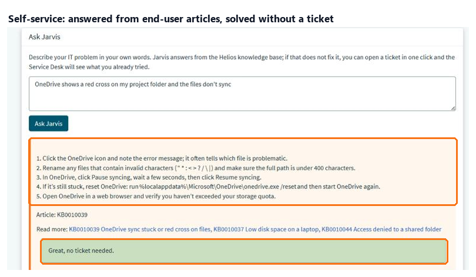
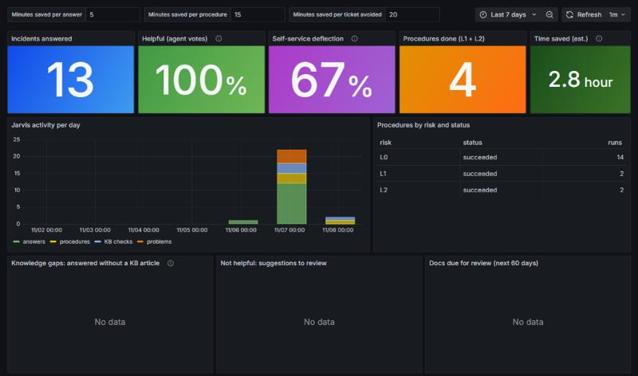
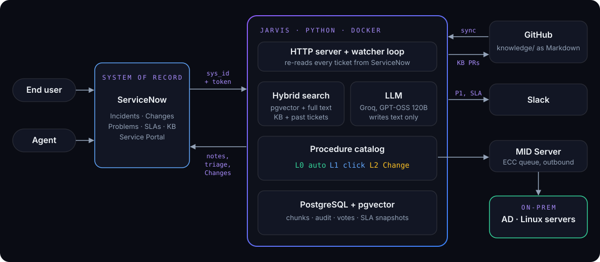

<!-- Slide deck in Marp format. On GitHub it reads top to bottom; the interactive version is https://tortonef.github.io/jarvis-servicenow/ (built by .github/workflows/slides.yml). Export locally (theme from .marprc.yml): npx @marp-team/marp-cli docs/deck.md --pdf -->

<!-- _class: lead -->
<!-- _paginate: false -->
<!-- _header: GenAI Lab · Project -->

# **Jarvis**

### An AI assistant for the IT Service Desk on ServiceNow

From a new ticket to a verified fix, with a human approving every action that matters.

ServiceNow Groq · GPT-OSS 120B PostgreSQL + pgvector MID Server Free tiers

[← Project on GitHub](https://github.com/tortonef/jarvis-servicenow)

---

<!-- _header: 01 · The problem -->

## Monday, 9:00 at the Service Desk

- **40 new incidents** overnight.
- The answer to most of them is already written: a KB article, a runbook, a ticket closed last month.
- The agent searches, reads, copies steps, checks AD by hand, asks the server team about a disk.
- Meanwhile a P1 SLA ticks towards breach.

INC "Can't log in"

INC "VPN error 809"

INC "Teams: nobody hears me"

P1 SLA at 78%

> **The knowledge exists. Finding it and acting on it is the slow part.**

---

<!-- _class: statement -->
<!-- _header: 02 · The idea -->

## What if every ticket arrived with its **answer**?

Jarvis reads every new incident, searches the knowledge base and past tickets, and writes a resolution suggestion on the ticket in a few seconds.

---

<!-- _header: 03 · How it works -->

## One ticket's journey

### 1 · Ticket
The user opens it, or first asks Jarvis on the Service Portal.

### 2 · Call
ServiceNow calls Jarvis with only the ticket id and a token.

### 3 · Search
Hybrid search over the KB and similar resolved incidents.

### 4 · Diagnose
Read-only checks run on-prem: is the account locked? is the disk full?

### 5 · Suggest
The LLM writes the note; triage fills category and group if empty.

### 6 · Fix
Rules propose a fix, the agent approves, Jarvis runs and verifies it.

---

<!-- _header: 04 · Knowledge first -->

## Docs as code

- Articles and runbooks are **Markdown in Git**. The pull request review *is* the KB approval.
- Merged docs are **published one-way** to the ServiceNow KB: nobody edits them there, so they never drift.
- **Hybrid, chunked search** finds paraphrases and exact error codes alike.

| Retrieval | Hit rate |
|---|---|
| Keyword (ServiceNow-style) | 80% |
| Semantic, whole documents | 78% |
| **Hybrid, chunked (Jarvis)** | **98%** |

CI fails any change that drops hybrid below 85%.

---

<!-- _header: 05 · From answer to action -->

## Diagnose, propose, approve, **verify**

1. **Diagnose.** L0 checks run on-prem through the MID Server.
2. **Propose by rule.** Account locked → propose the unlock.
3. **Approve.** One click by the agent, recorded in their name.
4. **Act and verify.** Jarvis re-checks, runs, re-checks, and resolves only if the check passes.

---

<!-- _header: 06 · Risk levels -->

## Risk decides who **approves**

| Level | What | Example | Approval |
|---|---|---|---|
| L0 | Read-only diagnostics | AD lockout status, disk usage, portal health | None: runs automatically |
| L1 | Safe, contained fix | Unlock an AD account, clean old logs | One click by the agent |
| L2 | Affects other users | Restart the portal service | An approved ServiceNow **Change** |

> For L2, Jarvis files a Normal Change built from the runbook: plan, backout and test. ServiceNow's Change model enforces the approvals; Jarvis acts only once it is in *Implement*.

---

<!-- _header: 07 · Safety by design -->

## The model writes **text**. It never chooses an **action**.

### Fixed catalog
Procedures live in code, not in the docs and not in the model. Publishing a document can never enable an action.

### Rules propose
A fix is proposed by rules on diagnostic results (`locked == true`, volume ≥ 80%), with parameters taken from data.

### Every layer agrees
Parameter checks, named MID functions, AD delegation (`lockoutTime` only), SSH forced commands, `sys_id` + token.

> On-prem is reached **only through the MID Server**: outbound only, audited in the ECC queue.

---

<!-- _header: 08 · Two processes, one brain -->

## Users and **operations**

### End users: self-service first
Answers on the Service Portal from employee articles only. *Solved*, or a ticket that already carries the question and the answer tried.

### Maintenance team
Problems proposed from clusters of similar incidents. P1 incidents on Slack with a first diagnosis. L2 work through Change.

---

<!-- _header: 09 · Watcher -->

## Nothing slips past the **SLA**

Every few minutes Jarvis reads the backlog and the running SLAs from ServiceNow.

- At **75%** and at **breach**: a work note with the fix, and the same alert on Slack.
- An **Operations** dashboard: open, at-risk and breached tickets, backlog by priority and group.

---

<!-- _header: 10 · Quality loop -->

## It learns, and it is **measured**

- **Agents rate** every suggestion: helpful or not, per agent.
- **Gaps become pull requests**: an undocumented fix turns into a draft article on GitHub, reviewed like code.
- **Hours saved** shown as an *editable estimate*, not a claim.

---

<!-- _header: 11 · Architecture -->

## How it fits **together**

---

<!-- _header: 12 · Stack -->

## Built on **free tiers**

One `docker compose up` starts everything and installs the ServiceNow side.

> Ticket text stays on the machine for search: embeddings are local.

| Piece | Choice |
|---|---|
| ITSM | ServiceNow Developer Instance |
| LLM | Groq, GPT-OSS 120B (any OpenAI-compatible API) |
| Embeddings | Local, `bge-small-en-v1.5` |
| Database | PostgreSQL + pgvector |
| On-prem lab | Samba AD, Linux, MID Server in Docker |
| Dashboards | Grafana on a read-only role |

---

<!-- _header: 13 · Roadmap -->

## Seven phases, all **done**

| Phase | Delivered |
|---|---|
| 0 · Foundations | Docker, PostgreSQL, CI, self-registering tunnel |
| 1 · Knowledge platform | Docs as code, hybrid search, publish to the KB |
| 2 · On-prem bridge | Samba AD lab, MID Server, first read-only check |
| 3 · Procedure catalog | L0 auto-diagnostics, L1 one-click fixes, audit trail |
| 4 · Processes | Self-service, L2 through Change, Problems, weekly report |
| 5 · Quality loop | Ratings, Grafana, KB gaps as pull requests |
| 6 · Watcher | Backlog snapshots, SLA alerts with the fix |

---

<!-- _class: lead -->
<!-- _header: Try it -->

# Try **Jarvis**

### Free PDI + free Groq key → `docker compose up -d --build`

Open an incident: the suggestion appears in seconds.

[Features](https://github.com/tortonef/jarvis-servicenow/blob/main/docs/features.md) [Design](https://github.com/tortonef/jarvis-servicenow/blob/main/docs/design.md) [Knowledge as code](https://github.com/tortonef/jarvis-servicenow/blob/main/docs/knowledge-as-code.md) [On-prem lab](https://github.com/tortonef/jarvis-servicenow/blob/main/docs/on-prem-lab.md)

[github.com/tortonef/jarvis-servicenow](https://github.com/tortonef/jarvis-servicenow)
