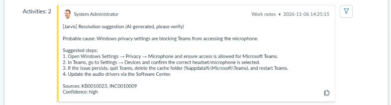
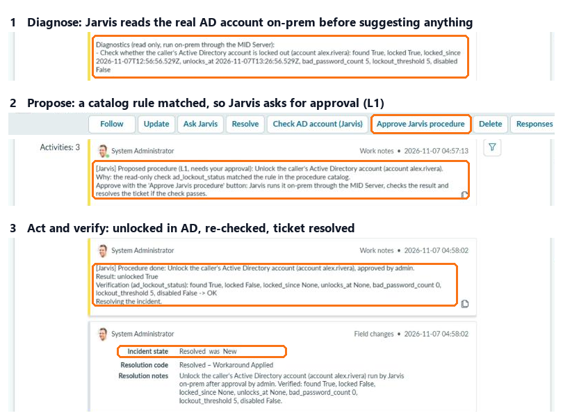
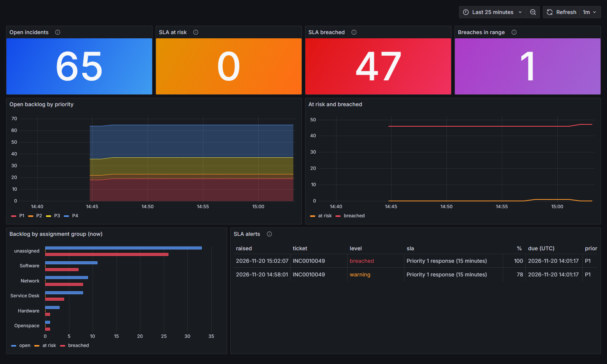
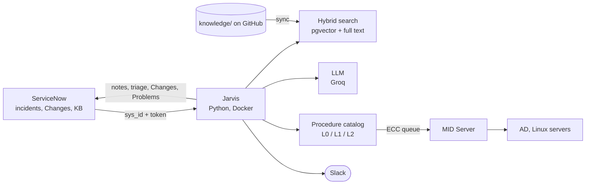

<!-- Slide deck in Marp format. On GitHub it reads top to bottom; to present it or export PDF/PPTX: npx @marp-team/marp-cli docs/deck.md --pdf -->

# Jarvis

### An AI assistant for the IT Service Desk on ServiceNow

From a new ticket to a verified fix, with a human approving every action that matters.

[← Back to the README](../README.md)

---

## Monday, 9:00 at the Service Desk

- 40 new incidents overnight. *"Can't log in."* *"VPN error 809."* *"Teams: nobody hears me."*
- The answer to most of them is already written somewhere: a KB article, a runbook, a ticket someone closed last month.
- The agent searches, reads, copies steps, checks AD by hand, asks the server team to look at a disk.
- Meanwhile a P1 SLA ticks towards breach, and nobody notices until it is red.

**The knowledge exists. Finding it and acting on it is the slow part.**

---

## What if every ticket arrived with its answer?

Jarvis reads every new incident, searches the knowledge base and past tickets, and writes a resolution suggestion on the ticket in a few seconds.

Probable cause, steps, confidence, and the sources it used: the KB article and the resolved ticket.

---

## One ticket's journey

1. **The user opens a ticket**, or first asks Jarvis on the Service Portal.
2. **ServiceNow calls Jarvis** (Business Rule or the *Ask Jarvis* button), with only the ticket id.
3. **Jarvis searches** its knowledge (hybrid: full text + vectors) and similar resolved incidents.
4. **Read-only checks run on-prem** through the MID Server: is the account locked? is the disk full?
5. **The LLM writes the note**; triage fills category and group if nobody has.
6. **A fix is proposed** if the rules say so. The agent approves, Jarvis runs it, verifies, resolves.

---

## Knowledge first: docs as code

- Articles and runbooks are **Markdown in Git**, reviewed by pull request. The review *is* the KB approval.
- Merged docs are **published one-way** to the ServiceNow KB: agents and the portal read them natively, nobody edits them there, so they never drift.
- **Hybrid search, chunked** finds both paraphrases and exact error codes:

| Retrieval | Hit rate |
|---|---|
| Keyword (ServiceNow-style) | 80% |
| Semantic, whole documents | 78% |
| **Hybrid, chunked (Jarvis)** | **98%** |

CI fails any change that drops hybrid below 85%.

---

## From answer to action

**Diagnose → propose → approve → act and verify.** The ticket is resolved only if the check after the fix passes.

---

## Risk levels decide who approves

| Level | What | Example | Approval |
|---|---|---|---|
| **L0** | Read-only diagnostics | AD lockout status, disk usage, portal health | None: runs automatically |
| **L1** | Safe, contained fix | Unlock an AD account, clean old logs | One click by the agent |
| **L2** | Affects other users | Restart the portal service | An approved ServiceNow **Change** |

For L2, Jarvis files a Normal Change built from the runbook (plan, backout, test). ServiceNow's Change model enforces the approvals; Jarvis acts only once it is in *Implement*.

---

## The model writes text. It never chooses an action.

- Procedures come from a **fixed catalog** in code, not from the docs and not from the model.
- A fix is proposed by **rules on diagnostic results** (`locked == true`, volume ≥ 80%), with parameters taken from data.
- **Layered allowlists**: catalog, parameter checks, named MID functions, AD delegation (`lockoutTime` only), SSH forced commands. All must agree.
- **Untrusted caller**: ServiceNow sends only a `sys_id` and a token; Jarvis re-reads the ticket itself.
- On-prem is reached **only through the MID Server**: outbound only, audited in the ECC queue.

---

## Two processes, one brain

**End users: self-service before the ticket**
Jarvis answers on the Service Portal from employee articles only. *Solved*, or open a ticket that already carries the question and the answer tried.

**Maintenance team**
Problems proposed from clusters of similar incidents. P1 incidents on Slack with a first diagnosis. L2 work through Change.

---

## Nothing slips past the SLA

Every few minutes Jarvis reads the backlog and the running SLAs from ServiceNow.

- At **75%** and at **breach**: a work note with the fix, and the same alert on Slack.
- An **Operations** dashboard: open, at-risk and breached tickets, backlog by priority and group.

---

## It learns, and it is measured

- **Agents rate every suggestion**: helpful / not helpful, stored per agent.
- **Gaps become pull requests**: a resolved ticket with an undocumented fix turns into a draft article on GitHub, reviewed like code.
- **A dashboard of what Jarvis saved**: answers, helpful share, deflection, procedures, and hours saved as an *editable estimate*, not a claim.

---

## How it fits together

ServiceNow stays the record for tickets, approvals and SLAs. PostgreSQL holds only Jarvis's own data.

---

## Built on free tiers

| Piece | Choice |
|---|---|
| ITSM | ServiceNow Personal Developer Instance |
| LLM | Groq, GPT-OSS 120B (any OpenAI-compatible API) |
| Embeddings | Local, `bge-small-en-v1.5`: ticket text stays on the machine |
| Database | PostgreSQL + pgvector |
| On-prem lab | Samba AD and Linux servers in Docker, ServiceNow MID Server |
| Dashboards | Grafana, read-only database role |

One `docker compose up` starts it all and installs the ServiceNow side.

---

## Where it stands

| Phase | Delivered |
|---|---|
| 0. Foundations | Docker, PostgreSQL, CI, self-registering tunnel |
| 1. Knowledge platform | Docs as code, hybrid search, publish to ServiceNow KB |
| 2. On-prem bridge | Samba AD lab, MID Server, first read-only check |
| 3. Procedure catalog | L0 auto-diagnostics, L1 one-click fixes, audit trail |
| 4. Processes | Self-service, L2 through Change, Problems, weekly report |
| 5. Quality loop | Ratings, Grafana, KB gaps as pull requests |
| 6. Watcher | Backlog snapshots, SLA alerts with the fix |

All done. Known limit: the quick tunnel's URL changes; a named tunnel fixes it when a stable URL matters.

---

## Try it

1. Free **ServiceNow PDI** and free **Groq key**.
2. `cp .env.example .env` and fill it in.
3. `python -m seed.seed` to load demo incidents.
4. `docker compose up -d --build`.

Open an incident: the suggestion appears in seconds.

**[Features](features.md) · [Design](design.md) · [Knowledge as code](knowledge-as-code.md) · [On-prem lab](on-prem-lab.md)**
