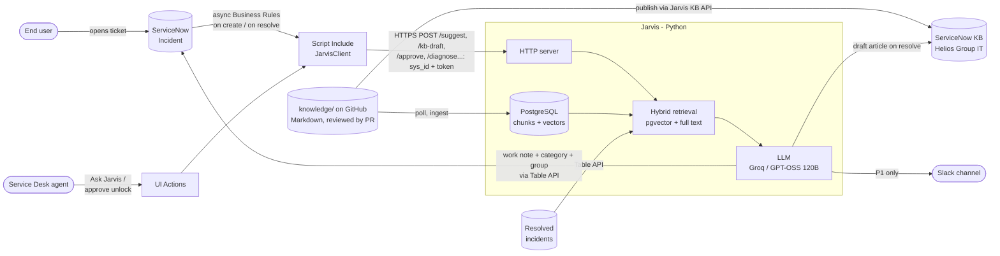
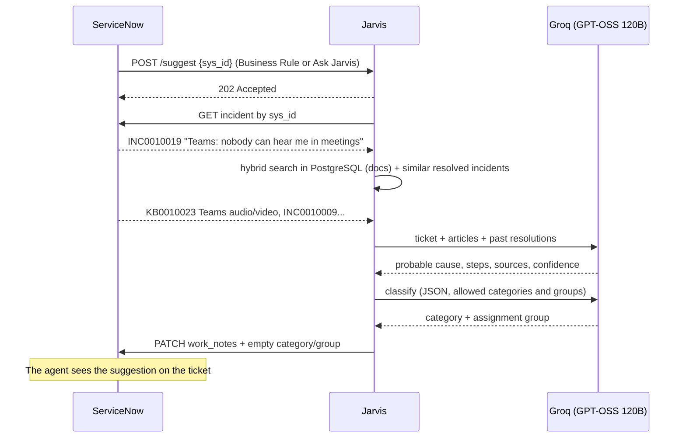

[← Back to the README](../README.md)

# Architecture and design choices

## Detailed flow

## Design choices

| Choice | Why |
|---|---|
| **ServiceNow stays the record for tickets** | Incidents, approvals and history live in ServiceNow; PostgreSQL holds only Jarvis's own data: the knowledge index, vector cache and audit trail. |
| **Docs as code, one-way to ServiceNow** | Git gives versioning, review by pull request and a quality gate for free; the ServiceNow KB is a read-only mirror, so the two never drift. |
| **Local embeddings** | Free and private: ticket text never leaves the machine for search. |
| **Push, with polling as fallback** | An async Business Rule and the *Ask Jarvis* button call Jarvis right away. Where ServiceNow cannot reach Jarvis, `jarvis.main` polls instead (no tunnel, nothing installed in ServiceNow). |
| **Untrusted caller** | The Jarvis endpoint requires a shared token, accepts only a 32-hex `sys_id` and re-reads the incident from ServiceNow; it never trusts ticket text sent in the request. |
| **A single LLM call (RAG)** | More predictable and faster than a tool-calling agent, and fits the free-tier limits. |
| **Dedicated KB with Instant Publish** | The PDI's "IT" KB has an approval flow; in *Helios Group IT* the approval is the pull request, and the stock KBs stay untouched. |
| **OpenAI-compatible API** | Groq, local Ollama, Gemini, OpenAI or Claude: just change `.env`. |
| **Triage never overrides people** | LLM output is checked against ServiceNow's own categories and groups; invented values are dropped, fields an agent already set are left alone, and a triage failure never blocks the resolution note. |
| **KB drafts need a human** | Jarvis only opens pull requests or creates drafts; publishing stays a human decision. Model output is HTML-escaped before it goes into the article, and a `covered_by` answer is trusted only if it names an article Jarvis actually showed the model. |
| **Actions are layered allowlists** | The model never picks or writes an action. The catalog, Jarvis's parameter checks, the MID Script Includes (named functions, `OU=Staff` only, allowed hosts and verbs), AD delegation (`svc_jarvis` may write `lockoutTime` and nothing else) and an SSH forced command on each server must all agree. A call to `/approve` without a pending proposal and the agent's approval note does nothing, even with a valid token. |
| **Alerts can't be hijacked by ticket text** | Ticket text is escaped before it reaches Slack, so a title like `<!channel>` cannot ping the whole channel. A Slack outage is logged and never costs the work note. |
| **On-prem only through the MID Server** | ServiceNow's own outbound-only bridge: no firewall opening into the lab, ServiceNow keeps the ECC queue as an audit trail, and Jarvis can only call named MID functions. |
| **L2 needs an approved Change** | Jarvis files the Change, but only ServiceNow's Change model can move it to Implement; Jarvis then re-reads the Change, needs it approved and in Implement, and its correlation id and number must match the pending L2 in its log. |
| **Self-service sees only end-user articles** | The portal search filters on the document audience; runbooks and admin procedures never reach employees, and the answer prompt refuses admin steps. |
| **Work note, not a comment** | The suggestion is visible to agents only, never to the end user. |
