[← Back to the README](../README.md)

# Features

Screenshots from the real ServiceNow PDI, the lab, Grafana and Slack.

## Resolution suggestion

A user opens the ticket *"Teams: nobody can hear me in meetings"*. The Business Rule calls Jarvis and about 6 seconds later the agent finds Jarvis's work note in the activity stream:

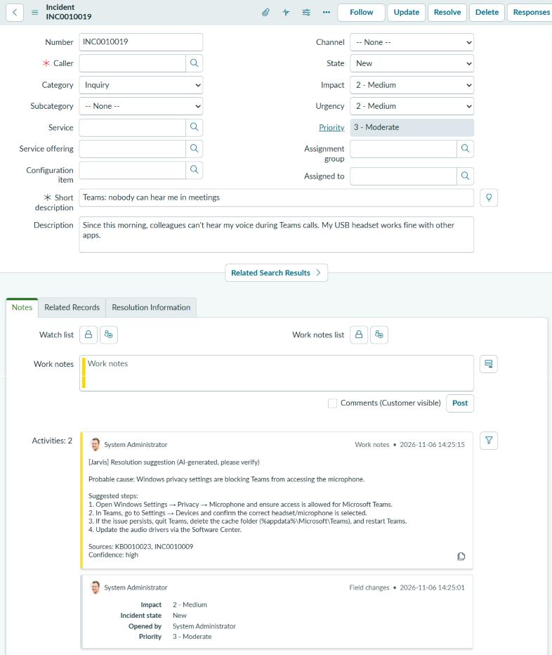

The suggestion comes from article **KB0010023** in the demo knowledge base and from resolved ticket **INC0010009**:

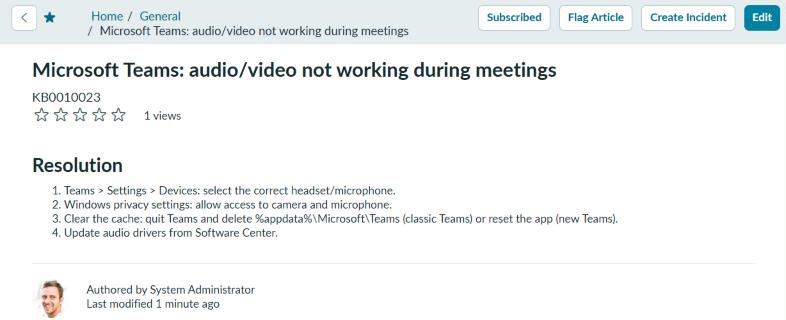

## Ask Jarvis button

Agents can also ask Jarvis on any existing ticket. Here it works on one of the PDI's own demo incidents: no article in the demo KB fits, so Jarvis builds on a similar past ticket and a stock KB article, and honestly reports *medium* confidence.

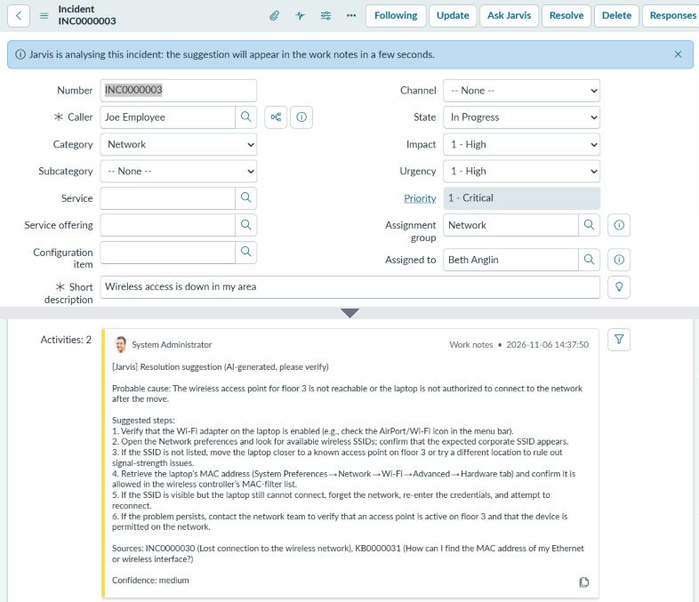

## Auto-triage

Jarvis also picks the category and the assignment group. It fills them **only if nobody has set them yet** (category still *Inquiry*, no group), and always writes its choice in the note. Allowed values come from ServiceNow itself: the incident categories and the groups that already handle incidents.

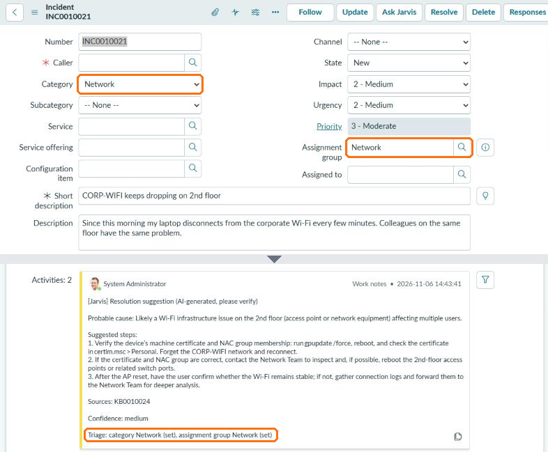

## Learning loop: KB drafts from resolved tickets

When an incident is resolved, Jarvis reads the agent's resolution notes and the closest articles. If the fix is already documented, it says so and creates nothing. Otherwise it writes a **draft** article, linked to the incident, for a human to review and publish. The next time the same problem comes in, Jarvis finds the answer:

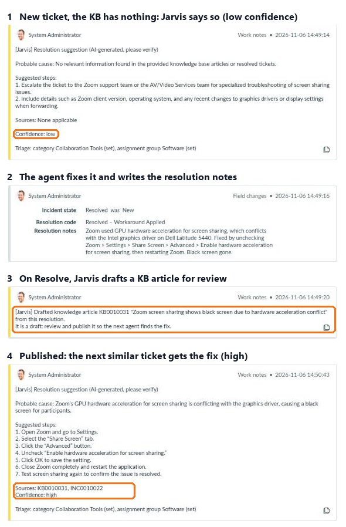

The draft Jarvis wrote from the agent's notes, linked back to the source incident:

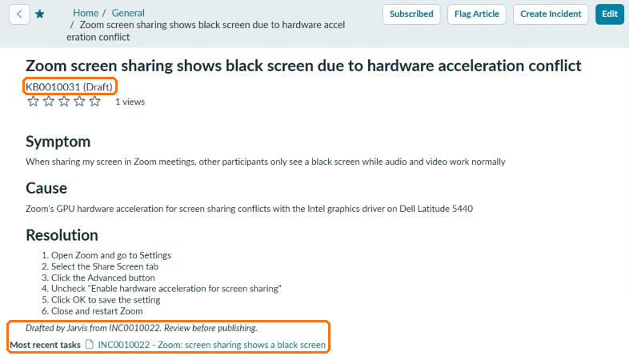

## Procedures: diagnose, propose, approve, verify

Jarvis can act on real systems, within a catalog it cannot change. [`procedures/catalog.yaml`](../procedures/catalog.yaml) lists what exists, each with a risk level, the knowledge documents it belongs to, validated parameters and the rules for proposing and verifying it:

| Procedure | Risk | Runs on |
|---|---|---|
| `ad_lockout_status` | L0, read only, automatic | lab AD (`dc01`) |
| `ad_unlock_account` | L1, agent approval | lab AD (`dc01`) |
| `linux_disk_usage` | L0 | `app01`, `app02` |
| `linux_clean_logs` | L1 | `app01`, `app02` |
| `portal_health` | L0 | `app01`, `app02` |

1. **Diagnose, then suggest.** The L0 checks linked to the documents retrieval found run first, on-prem through the MID Server, and their results go into the prompt and the note.
2. **Propose by rule, not by model.** An L1 is proposed only when its `propose_if` rule holds on those results (account `locked` is true, log volume at least 80%). Parameters come from data: the caller's user name, or the one server named in the ticket out of a fixed list; ambiguous tickets get no proposal.
3. **Approve.** *Approve Jarvis procedure* is shown only while the latest Jarvis note is an open proposal; the click records the approval in the agent's name.
4. **Act and verify.** Jarvis re-checks that the procedure is still needed, runs it, re-runs the L0 check against the `verify` rule, and resolves the ticket only if it passes. Every run, automatic or approved, is logged in the `execution` table.

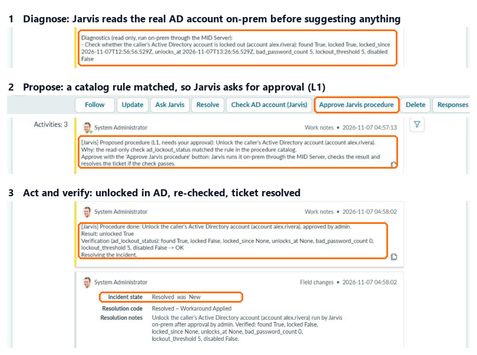

The same flow on a Linux server: a ticket about `app01`'s full log volume got two automatic checks (volume 84%, portal healthy), a cleanup proposal, and after approval 40 old logs were deleted, the volume dropped to 1% and the ticket was resolved.

## Support processes

**End users: self-service before the ticket.** The Service Portal page `/sp?id=jarvis_help` has an *Ask Jarvis* widget. Jarvis answers only from articles written for employees (runbooks are never shown), in plain steps the user can do alone, and treats the question as data, not instructions. The user clicks *This solved my problem* or *open a ticket*; the ticket then carries the question and the answer already tried, so the agent's suggestion starts from there. Every answer and its outcome is stored, which gives the deflection rate.

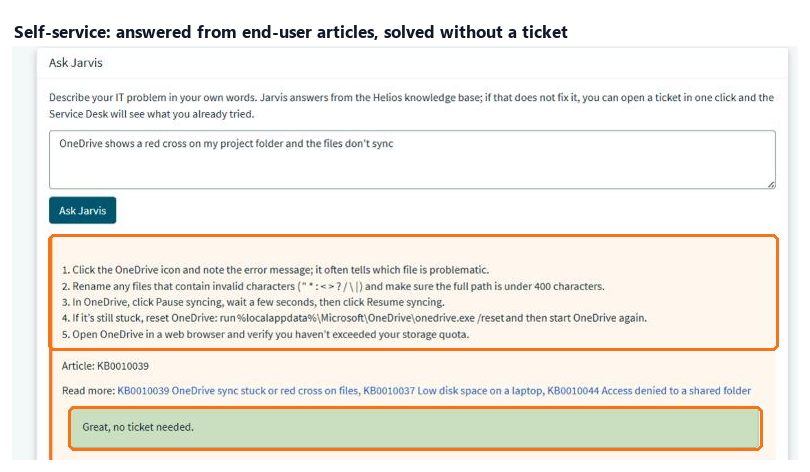

**Maintenance: L2 procedures go through Change.** Restarting the portal affects other users, so `portal_restart` is L2: when `portal_health` reports it down, Jarvis does not offer a button. It files a Normal Change built from runbook RB-SRV-002 (implementation plan from *Pre-checks* and *Steps*, backout plan from *Rollback*, test plan from the `verify` rule) and sends it for approval. ServiceNow's Change model enforces the group and CAB approvals; when the approved Change moves to *Implement*, Jarvis re-checks, restarts the service through the MID Server, verifies, closes the Change as *successful* or *unsuccessful* and resolves the incident.

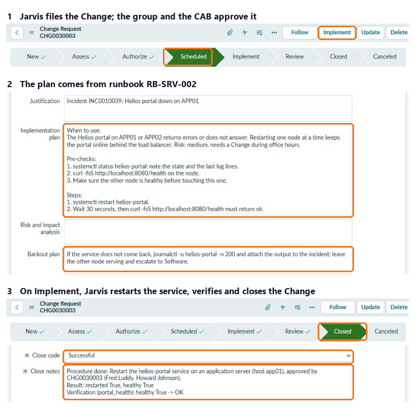

**Problems from clusters.** When at least 3 open incidents from the last 24 hours look alike (semantic similarity 0.8 or more), Jarvis files a Problem with the incidents, its likely cause, and links them; later look-alikes join the open Problem. Similarity measures symptoms, not causes: a hotel VPN error scores 0.82 against an office-wide VPN outage, so the Problem is a proposal and the problem manager unlinks what does not belong.

**Weekly report.** Every Monday Jarvis posts to Slack: incidents answered and those with no matching article, self-service deflection, procedures run by risk and status, failures, Problems proposed and documents due for review (`python -m jarvis.report` prints it any time).

## Quality loop

**Agents rate every suggestion.** Tickets with a Jarvis suggestion get *Jarvis: helpful* and *Jarvis: not helpful* buttons. The vote is a work note in the agent's name; Jarvis reads author and verdict back from ServiceNow (the request only names the ticket), stores one vote per agent per ticket and links it to the answer it rates.

**A dashboard of what Jarvis saved.** `docker compose up` also starts Grafana on [127.0.0.1:3300](http://127.0.0.1:3300) (user `admin`, password `GRAFANA_ADMIN_PASSWORD`) with a provisioned dashboard: incidents answered, share of helpful votes, self-service deflection, procedures done, and an **estimate** of agent hours saved, with the minutes per answer, procedure and avoided ticket as editable assumptions at the top. Tables list knowledge gaps (answers with no article), suggestions rated not helpful and docs due for review. Grafana logs in as `grafana_reader`, a role Jarvis creates with `SELECT` rights only.

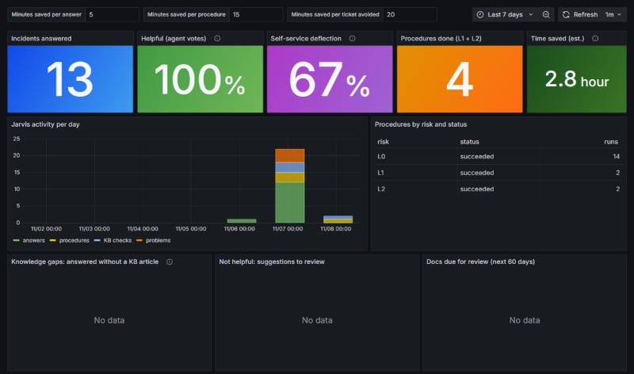

**Knowledge gaps become pull requests.** With `GITHUB_TOKEN` set (a fine-grained token for this repository only, *Contents* and *Pull requests* read/write), a resolved incident whose fix is not documented becomes a pull request adding `knowledge/articles/<title>-<incident>.md`, with front matter filled in and a temporary id `KB-<incident>-001`. CI validates it like any doc, a human reviews and merges it, and the next sync publishes it to ServiceNow. Model output is flattened to one line per field, so it cannot add sections or break the front matter. Without a token, Jarvis falls back to a draft article in ServiceNow.

## P1 alerts on Slack

When the ticket is a P1 (impact and urgency high), Jarvis posts to a Slack channel as soon as its suggestion is ready: title linked to the incident, probable cause, confidence and KB sources, so the on-call team starts from a diagnosis instead of a bare alert. Set `NOTIFY_WEBHOOK_URL` to a Slack [Incoming Webhook](https://api.slack.com/messaging/webhooks); leave it empty to disable.

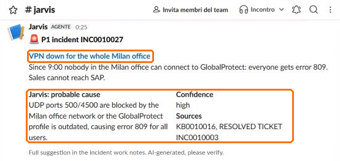

