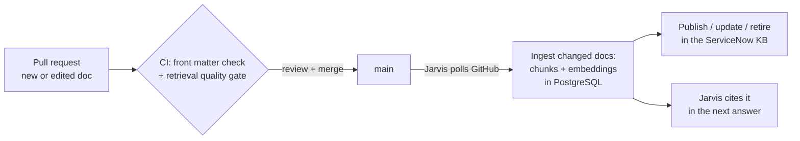

[← Back to the README](../README.md)

# Knowledge base as code

The documentation of **Helios Group**, a fictional company with its own domain, servers and teams, lives in [`knowledge/`](../knowledge/): about 30 documents, articles for users and the Service Desk and runbooks for the maintenance team, Markdown with validated front matter. Changing the knowledge base is a pull request:

- **Search** is hybrid: meaning (local embeddings, [fastembed](https://github.com/qdrant/fastembed) `BAAI/bge-small-en-v1.5`, no API key) plus a small full-text bonus for exact commands and codes, in one PostgreSQL query. Each document is split into a title + symptoms chunk and one chunk per section.
- **Publishing**: ServiceNow refuses to edit published articles through the Table API, so the installer adds a small Scripted REST API (*Jarvis KB*) that creates, updates and retires articles server side. Articles are matched on the document id, so editing a doc updates the same KB number.
- **Only changes move**: documents are skipped by content hash; a deleted doc retires its article. A malformed doc stops the sync and Jarvis keeps serving the last good knowledge base.

Retrieval quality on 40 tickets written the way users and engineers write them (`python -m tests.eval_search`):

| Search | Right document first |
|---|:---:|
| Keyword (ServiceNow-style `LIKE` + ranking) | 80% |
| Semantic, whole documents | 78% |
| **Hybrid, chunked (what Jarvis uses)** | **98%** |

Most of the gain comes from chunking: one vector per section keeps a long runbook from diluting its meaning. The full-text part adds the exact-command cases (*"repadmin shows errors"*). The cases were written together with the documents, so treat 98% as optimistic; CI fails any change that drops hybrid below 85%.
