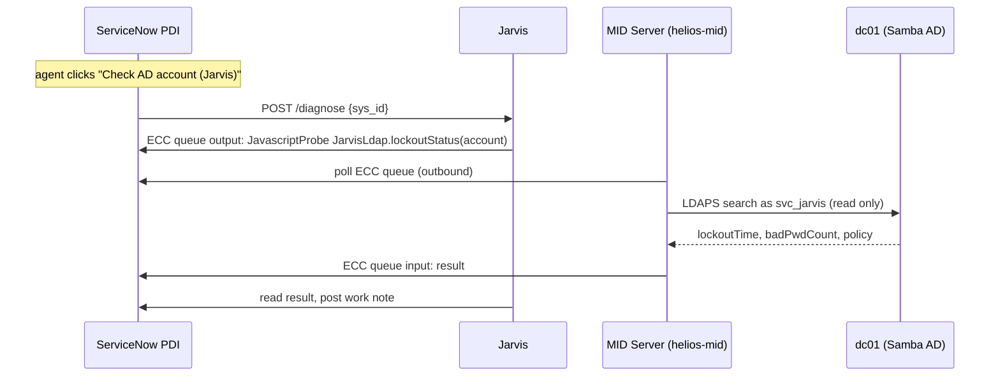
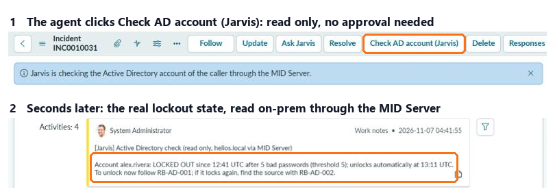

[← Back to the README](../README.md)

# On-prem lab and MID Server

Jarvis can check real systems on-prem without any inbound connection to them. The lab is a **Samba Active Directory** for `helios.local` (domain controller `dc01`, users in `OU=Staff`, lockout after 5 bad passwords), built from Debian's own packages. A **ServiceNow MID Server**, built from ServiceNow's official container recipe, is the only component that talks to it, and it only connects outbound to the PDI.



- **No paid plugins**: the IntegrationHub SSH and PowerShell steps are not active on a PDI, so Jarvis sends a *JavascriptProbe* that calls a fixed function in a MID Server Script Include (`JarvisLdap`). Only named calls exist (`jarvis/mid.py`), and the account name is validated on the MID before it reaches the LDAP filter.
- **Least privilege**: the MID signs in as `mid.helios` (role `mid_server`, web service access only); LDAP uses `svc_jarvis`, an ordinary account with no admin rights. Its password lives only in the MID container and never passes through ServiceNow.
- **Speed**: about 3 seconds per check once the MID is warm (the very first probe after start took about a minute while the MID synchronized).

<p align="center"></p>

To lock a lab user the way it happens in real life (6 bad passwords): `sh lab/lock-user.sh alex.rivera`.

To run the lab: download ServiceNow's `mid-linux-container-recipe` for your instance version into `lab/mid/recipe/` (it is not redistributed here), then:

```bash
docker build -t mid:brazil-patch2 lab/mid/recipe
```

```bash
docker compose --profile lab up -d --build
```

Set `MID_USER`, `MID_PASSWORD` and the `LAB_*` passwords in `.env` first, and validate the MID Server once in ServiceNow (**MID Server > Servers > helios-mid > Validate**).
